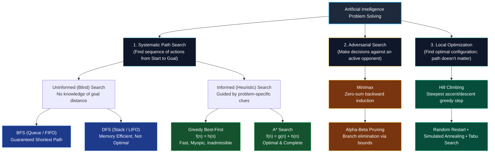
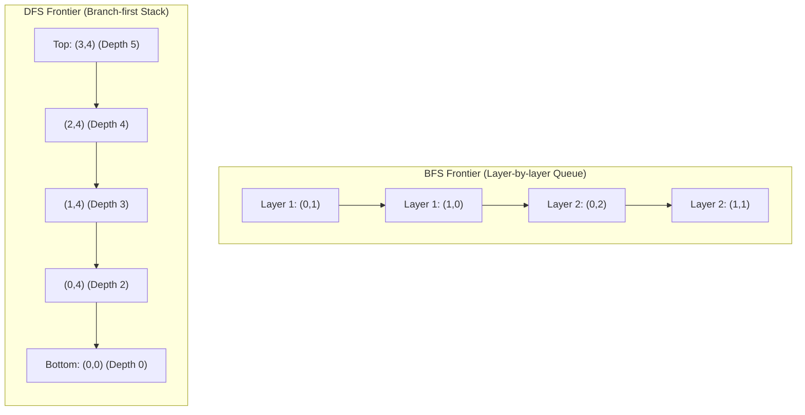
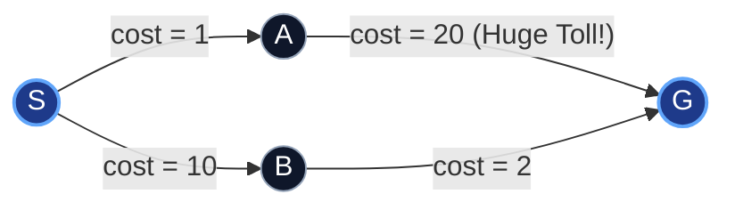
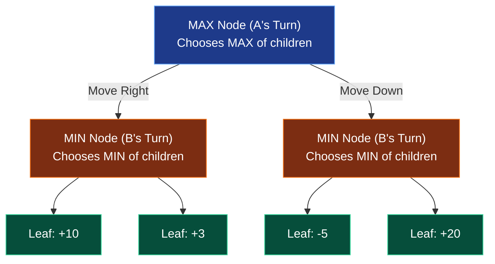
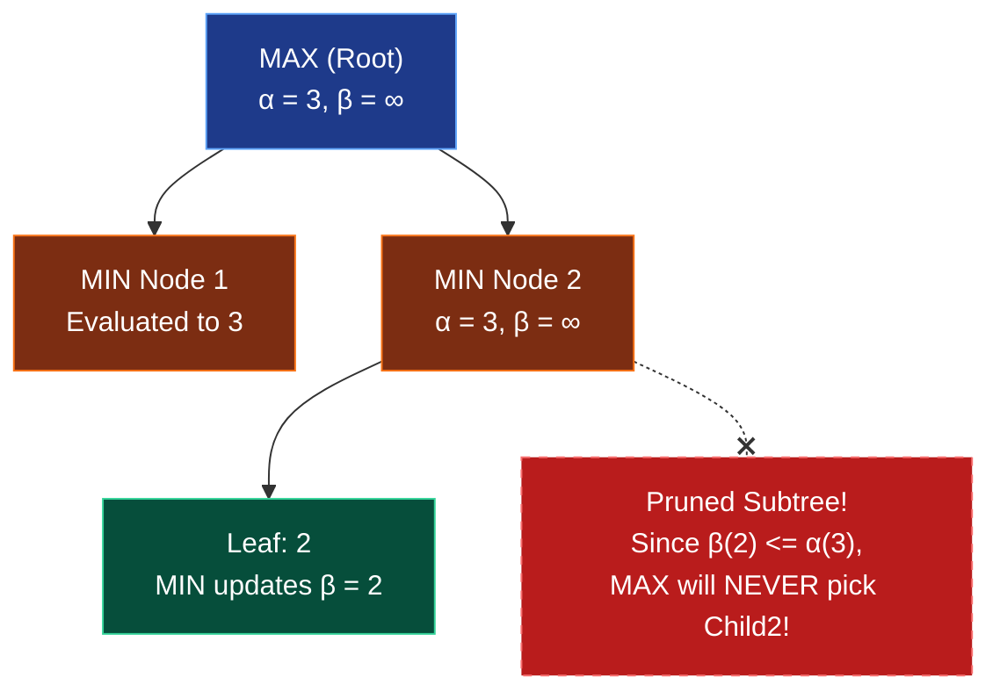
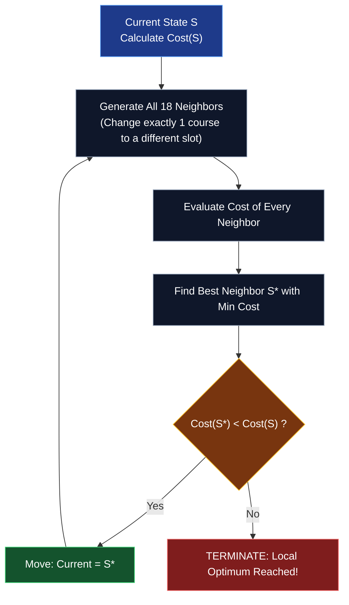

# The Ultimate Artificial Intelligence Search & Optimization Masterclass
## Comprehensive Educational Guide & Concept Mastery
**Course:** Artificial Intelligence | **Repository:** `Group_assignement`  
**Topics:** Uninformed Search • Informed Heuristic Search • Adversarial Game Trees • Local Optimization & CSPs

---

## Table of Contents
1. [The AI Search Spectrum: The Big Picture](#1-the-ai-search-spectrum-the-big-picture)
2. [Module 1: Uninformed Search (BFS & DFS in Grid Navigation)](#2-module-1-uninformed-search-bfs--dfs-in-grid-navigation)
   - [1.1 Formal Problem Formulation](#11-formal-problem-formulation)
   - [1.2 Breadth-First Search (BFS): Wavefront Exploration](#12-breadth-first-search-bfs-wavefront-exploration)
   - [1.3 Depth-First Search (DFS): Deep-Dive Exploration](#13-depth-first-search-dfs-deep-dive-exploration)
   - [1.4 The Stack Reverse-Pushing Nuance in DFS](#14-the-stack-reverse-pushing-nuance-in-dfs)
   - [1.5 Theoretical & Complexity Comparison](#15-theoretical--complexity-comparison)
   - [1.6 Step-by-Step Code Walkthrough (`q1.py`)](#16-step-by-step-code-walkthrough-q1py)
3. [Module 2: Informed Search (Heuristics, Greedy Best-First, and A*)](#3-module-2-informed-search-heuristics-greedy-best-first-and-a)
   - [2.1 The Philosophy of Heuristics](#21-the-philosophy-of-heuristics)
   - [2.2 Evaluation Functions: $f(n) = h(n)$ vs $f(n) = g(n) + h(n)$](#22-evaluation-functions-fn--hn-vs-fn--gn--hn)
   - [2.3 Mathematical Properties of Heuristics](#23-mathematical-properties-of-heuristics)
   - [2.4 Proof of A* Optimality](#24-proof-of-a-optimality)
   - [2.5 The Trap of Greed: Why Greedy Best-First Fails (Counterexample Trace)](#25-the-trap-of-greed-why-greedy-best-first-fails-counterexample-trace)
   - [2.6 Step-by-Step Code Walkthrough (`q2.py`)](#26-step-by-step-code-walkthrough-q2py)
4. [Module 3: Adversarial Search (Minimax & Alpha-Beta Pruning)](#4-module-3-adversarial-search-minimax--alpha-beta-pruning)
   - [3.1 Zero-Sum Games and Backward Induction](#31-zero-sum-games-and-backward-induction)
   - [3.2 The Minimax Algorithm & Value Propagation](#32-the-minimax-algorithm--value-propagation)
   - [3.3 Heuristic Evaluation in Depth-Limited Games](#33-heuristic-evaluation-in-depth-limited-games)
   - [3.4 Alpha-Beta Pruning: Derivation & Cutoff Conditions](#34-alpha-beta-pruning-derivation--cutoff-conditions)
   - [3.5 Move Ordering: The Secret to Maximum Pruning](#35-move-ordering-the-secret-to-maximum-pruning)
   - [3.6 Step-by-Step Code Walkthrough (`q3.py`)](#36-step-by-step-code-walkthrough-q3py)
5. [Module 4: Local Search & CSPs (Hill Climbing & Beyond)](#5-module-4-local-search--csps-hill-climbing--beyond)
   - [5.1 Path Search vs Local Search: The Conceptual Paradigm Shift](#51-path-search-vs-local-search-the-conceptual-paradigm-shift)
   - [5.2 Formulating Exam Timetabling as a CSP](#52-formulating-exam-timetabling-as-a-csp)
   - [5.3 Cost Landscapes: Hard vs Soft Constraints](#53-cost-landscapes-hard-vs-soft-constraints)
   - [5.4 Steepest-Ascent Hill Climbing Mechanics](#54-steepest-ascent-hill-climbing-mechanics)
   - [5.5 Anatomical Flaws of Hill Climbing (Local Minima, Plateaus, Ridges)](#55-anatomical-flaws-of-hill-climbing-local-minima-plateaus-ridges)
   - [5.6 Advanced Local Search Techniques (Restarts, Annealing, Tabu)](#56-advanced-local-search-techniques-restarts-annealing-tabu)
   - [5.7 Step-by-Step Code Walkthrough (`q4.py`)](#57-step-by-step-code-walkthrough-q4py)
6. [Master Synthesis & Comparison Cheatsheet](#6-master-synthesis--comparison-cheatsheet)
7. [Self-Check Quiz & Exam-Style Questions](#7-self-check-quiz--exam-style-questions)

---

# 1. The AI Search Spectrum: The Big Picture

In Artificial Intelligence, **search** is the universal problem-solving paradigm. Whenever an intelligent agent cannot simply map an input directly to an output via a closed-form formula, it must **search** through a space of possibilities to discover an optimal or satisfactory state or sequence of actions.

This assignment systematically traverses the four foundational families of search algorithms:



### Key Differences Across the 4 Domains

| Paradigm | Search Goal | Environment Nature | Knowledge / Guidance | Memory Footprint | Assignment Question |
| :--- | :--- | :--- | :--- | :--- | :---: |
| **Uninformed Search** | Path from $S \to G$ | Deterministic, Static, Single-Agent | None (only graph topology) | BFS: Huge $\mathcal{O}(b^d)$<br/>DFS: Small $\mathcal{O}(bm)$ | **Q1** (`q1.py`) |
| **Informed Search** | Minimum-cost Path | Deterministic, Static, Single-Agent | Heuristic function $h(n)$ estimating distance to goal | Depends on $h(n)$ quality | **Q2** (`q2.py`) |
| **Adversarial Search** | Optimal move against rational adversary | Multi-agent, Zero-sum, Turn-based | Game rules + Static Evaluation function | Stack depth $\mathcal{O}(b \cdot d)$ | **Q3** (`q3.py`) |
| **Local Search** | Optimal State Configuration | Complete-state representation, optimization | Objective / Penalty Cost Function | Minimal: Only current state & neighbors $\mathcal{O}(1)$ | **Q4** (`q4.py`) |

---

# 2. Module 1: Uninformed Search (BFS & DFS in Grid Navigation)

## 1.1 Formal Problem Formulation
In classical AI, any problem being solved by systematic search must be formulated using the **5-tuple**:
1. **State Space ($S$):** All valid configurations. In grid navigation, a state is a coordinate pair:
   $$s = (r, c) \quad \text{where } 0 \le r < R \text{ and } 0 \le c < C$$
2. **Initial State ($s_0$):** Starting coordinates of the rescue robot:
   $$s_0 = (r_{\text{start}}, c_{\text{start}})$$
3. **Action Space ($A(s)$):** Four cardinal movements:
   $$\mathcal{A} = \{\text{UP}, \text{RIGHT}, \text{DOWN}, \text{LEFT}\}$$
4. **Transition Model ($\text{Result}(s, a)$):** Deterministic coordinate shifts:
   - $\text{UP}: (r-1, c)$
   - $\text{RIGHT}: (r, c+1)$
   - $\text{DOWN}: (r+1, c)$
   - $\text{LEFT}: (r, c-1)$
   *A transition is valid if and only if $0 \le r' < R$, $0 \le c' < C$, $\text{grid}[r'][c'] \ne \text{"#"}$, and $(r', c') \notin \text{Visited}$.*
5. **Goal Test ($\text{IsGoal}(s)$):** Boolean predicate checking whether $r = r_{\text{goal}}$ and $c = c_{\text{goal}}$.
6. **Path Cost ($c$):** Uniform step cost: $c(s, a, s') = 1$ for all steps. Total path cost is simply the total number of moves.

---

## 1.2 Breadth-First Search (BFS): Wavefront Exploration

### Core Principle
BFS explores the search space in concentric rings or "wavefronts." It expands the root node, then all successors of the root (depth 1), then all successors of those nodes (depth 2), and so on.

```
       Depth 0:             (Start)
                           /   |   \
       Depth 1:          [N1] [N2] [N3]       <-- All depth 1 expanded before depth 2
                        /  \    |    \
       Depth 2:       [N4] [N5][N6]  [N7]     <-- All depth 2 expanded before depth 3
```

### Data Structure: FIFO Queue
- Nodes are inserted at the back (**enqueue**) and removed from the front (**dequeue**).
- **Early Goal Testing vs Late Goal Testing:**
  - *Standard BFS* can check for the goal upon *generating* a child node (saving an extra layer of expansions).
  - *Graph Search BFS* checks either on generation or expansion; in this assignment, testing upon pop/expansion ensures uniform reporting across both BFS and DFS.
- **Visited Set:** Crucial for graph search! As soon as a node is added to the queue, it is marked visited. If you don't mark nodes visited, cycles in the grid ($A \to B \to A$) will cause an **infinite loop**.

### Optimality Guarantee of BFS
> **Theorem:** Breadth-First Search is guaranteed to find the shallowest (shortest) path if all step costs are equal ($c = 1$).
> 
> *Intuition:* Because BFS explores all paths of length $k$ before any path of length $k+1$, the first time the goal is popped, it is impossible for a shorter path to exist.

---

## 1.3 Depth-First Search (DFS): Deep-Dive Exploration

### Core Principle
DFS plunges as deeply as possible down each branch before backtracking. It follows a single path until it hits a dead end (obstacles, boundary, or visited cells), then backtracks to the most recent unvisited alternative.

```
       Step 1:  (Start)
                   |
       Step 2:   [N1]
                   |
       Step 3:   [N4]  (Dead End! Backtrack to N1)
                   |
       Step 4:   [N5]
```

### Data Structure: LIFO Stack
- Nodes are pushed to the top and popped from the top.
- DFS does **NOT** guarantee the shortest path! If the goal happens to sit just 2 steps to the left, but DFS starts exploring a long maze to the right, it may wander through 80 grid cells before finally discovering the goal or backtracking.

---

## 1.4 The Stack Reverse-Pushing Nuance in DFS

A common interview and assignment trick is enforcing a strict successor generation order:
$$\text{UP} \to \text{RIGHT} \to \text{DOWN} \to \text{LEFT}$$

### The Subtlety
A Stack is **Last-In, First-Out (LIFO)**.
If you iterate $i$ from 0 to 3 (pushing UP, then RIGHT, then DOWN, then LEFT):
- UP is pushed first $\to$ sits at the bottom.
- LEFT is pushed last $\to$ sits at the very top.
- The next `stack.pop()` will pop **LEFT**, which completely violates the rule!

### The Solution: Push in Reverse Order
```python
# To pop UP first, push in reverse order: LEFT, DOWN, RIGHT, UP
for i in range(3, -1, -1):
    nr = r + dr[i]
    nc = c + dc[i]
    if is_valid(nr, nc):
        visited.add((nr, nc))
        stack.append((nr, nc, path + [dir_names[i]]))
```
Now, UP was pushed last, so it sits on top of the stack and is popped **first**.

---

## 1.5 Theoretical & Complexity Comparison

Let:
- $b$ = Branching factor (maximum number of legal moves from a cell; on a 2D grid, $b \le 4$).
- $d$ = Depth of the shallowest goal.
- $m$ = Maximum depth of the state space ($m \le R \times C$).

| Metric | Breadth-First Search (BFS) | Depth-First Search (DFS) | Practical Implications |
| :--- | :--- | :--- | :--- |
| **Data Structure** | FIFO Queue (`collections.deque` or `list`) | LIFO Stack (Python `list` with `.pop()`) | Queue processes layer-by-layer; Stack processes branch-first |
| **Completeness** | **Yes** (if $b$ is finite) | **Yes** on finite graphs with visited set; **No** on infinite graphs without cycle check | BFS will never get stuck in an infinite corridor |
| **Optimality** | **Yes** (when all step costs are equal) | **No** (may find a circuitous 50-step path when an 8-step path existed) | Never use DFS if shortest path is required! |
| **Time Complexity** | $\mathcal{O}(b^d)$ | $\mathcal{O}(b^m)$ | Both can be exponential in worst case |
| **Space Complexity** | $\mathcal{O}(b^d)$ — **Exponential Memory!** | $\mathcal{O}(b \cdot m)$ — **Linear Memory!** | **The Achilles' Heel of BFS:** It runs out of RAM on deep graphs. DFS memory footprint is negligible. |

### Visualizing Search Frontiers



---

## 1.6 Step-by-Step Code Walkthrough (`q1.py`)

Here is how the core algorithms are structured cleanly and deterministically:

```python
# Grid Successor Offsets in strict order: UP -> RIGHT -> DOWN -> LEFT
dir_names = ["UP", "RIGHT", "DOWN", "LEFT"]
dr = [-1, 0, 1, 0]
dc = [0, 1, 0, -1]

# --- Breadth-First Search ---
queue = [(start_r, start_c, [])] # (row, col, path_list)
visited_bfs = {(start_r, start_c)}

while queue:
    r, c, path = queue.pop(0) # FIFO: pop front
    if r == goal_r and c == goal_c:
        # Goal reached with guaranteed minimal len(path)!
        break
    for i in range(4): # Forward order: UP, RIGHT, DOWN, LEFT
        nr, nc = r + dr[i], c + dc[i]
        if 0 <= nr < R and 0 <= nc < C and grid[nr][nc] != '#' and (nr, nc) not in visited_bfs:
            visited_bfs.add((nr, nc))
            queue.append((nr, nc, path + [dir_names[i]]))

# --- Depth-First Search ---
stack = [(start_r, start_c, [])]
visited_dfs = {(start_r, start_c)}

while stack:
    r, c, path = stack.pop() # LIFO: pop top
    if r == goal_r and c == goal_c:
        break
    # PUSH IN REVERSE so UP is on top!
    for i in range(3, -1, -1):
        nr, nc = r + dr[i], c + dc[i]
        if 0 <= nr < R and 0 <= nc < C and grid[nr][nc] != '#' and (nr, nc) not in visited_dfs:
            visited_dfs.add((nr, nc))
            stack.append((nr, nc, path + [dir_names[i]]))
```

---

# 3. Module 2: Informed Search (Heuristics, Greedy Best-First, and A*)

## 2.1 The Philosophy of Heuristics
Uninformed search wanders blindly through the graph, treating every unvisited node as equally promising.
**Informed Search** introduces a **Heuristic Function**, denoted $h(n)$:
$$h(n) = \text{Estimated cost of the cheapest path from node } n \text{ to the goal}$$

- In geographical routing: $h(n)$ can be Euclidean (straight-line) distance or Manhattan distance.
- At the goal node: $h(\text{Goal}) = 0$.
- For all valid states: $h(n) \ge 0$.

---

## 2.2 Evaluation Functions: $f(n) = h(n)$ vs $f(n) = g(n) + h(n)$

In informed search, we maintain a **Priority Queue (Frontier)** and always expand the node with the lowest value of an evaluation function $f(n)$.

```
   (Start) -------- g(n) --------> [Node n] -------- h(n) --------> (Goal)
      |<--- Cost already spent --->| |<--- Estimated remaining --->|
```

### 1. Greedy Best-First Search:
$$f(n) = h(n)$$
- **Philosophy:** *"I only care about how close the destination looks from here."*
- It completely ignores $g(n)$ (the cost already accumulated from the start).
- It is susceptible to deceptive shortcuts that look close to the goal but lead into impassable dead ends or high-toll expressways.

### 2. $A^*$ Search (A-Star):
$$f(n) = g(n) + h(n)$$
- $g(n)$: The exact cost incurred so far to reach node $n$ from the start.
- $h(n)$: The estimated cost remaining from node $n$ to the goal.
- $f(n)$: The estimated total cost of the complete path passing through node $n$.
- **Philosophy:** *"I balance how much I have already paid with how much more I expect to pay."*

---

## 2.3 Mathematical Properties of Heuristics

The entire theoretical foundation of $A^*$ rests on two mathematical definitions:

### Property 1: Admissibility (Optimistic)
A heuristic $h(n)$ is **admissible** if it **never overestimates** the true minimal cost to reach the goal, denoted $h^*(n)$:
$$\forall n, \quad 0 \le h(n) \le h^*(n)$$
*Intuition:* An admissible heuristic is optimistic. It thinks the goal is closer than it really is. Because it never exaggerates the cost, $A^*$ will never bypass a truly cheap route in favor of a route that merely looks cheap.

### Property 2: Consistency / Monotonicity (Triangle Inequality)
A heuristic $h(n)$ is **consistent** if, for every node $n$ and every successor $n'$ generated by action $a$:
$$h(n) \le c(n, a, n') + h(n')$$

```
          c(n, a, n')
    [n] ---------------> [n']
      \                  /
   h(n)\                / h(n')
        \              /
         v            v
             (Goal)
```
*Geometric Intuition:* By the Triangle Inequality, the direct distance from $n$ to Goal cannot be strictly greater than the cost of stepping from $n$ to $n'$ plus the distance from $n'$ to Goal.

> **Crucial Theorem:** 
> - Every consistent heuristic is admissible ($h \text{ consistent} \implies h \text{ admissible}$).
> - If $h(n)$ is consistent, the $f$-values along any path are **monotonically non-decreasing**:
>   $$f(n') = g(n') + h(n') = g(n) + c(n, a, n') + h(n') \ge g(n) + h(n) = f(n)$$
> - **Consequence for Graph Search:** When $A^*$ expands a node $n$, the path to $n$ is **guaranteed to be optimal**. You NEVER need to reopen or re-expand a closed node!

---

## 2.4 Proof of $A^*$ Optimality

> **Theorem:** Tree-search $A^*$ is optimal if $h(n)$ is admissible. Graph-search $A^*$ is optimal if $h(n)$ is consistent.

### Proof by Contradiction (Sketch):
1. Suppose a suboptimal goal node $G_2$ is selected for expansion from the frontier, with path cost $g(G_2) > C^*$, where $C^*$ is the optimal path cost.
2. Since $G_2$ is a goal, $h(G_2) = 0$, so $f(G_2) = g(G_2) + 0 = g(G_2) > C^*$.
3. Now consider an unexpanded node $n$ that lies on the true optimal path to the optimal goal $G$.
4. By admissibility, $h(n) \le h^*(n)$.
5. Therefore:
   $$f(n) = g(n) + h(n) \le g(n) + h^*(n) = C^*$$
6. Combining the inequalities:
   $$f(n) \le C^* < f(G_2) \implies f(n) < f(G_2)$$
7. Since $A^*$ always selects the frontier node with the lowest $f$-value, node $n$ MUST be selected before $G_2$.
8. Hence, $G_2$ can never be popped before the optimal path through $n$ is discovered. **Contradiction.** $\blacksquare$

---

## 2.5 The Trap of Greed: Why Greedy Best-First Fails (Counterexample Trace)

Consider the custom benchmark graph (`p2_test_case_2.txt`):



### Given Heuristics:
- $h(S) = 10$
- $h(A) = 2$  *(Looks tantalizingly close to Goal!)*
- $h(B) = 8$  *(Looks far away!)*
- $h(G) = 0$

### Trace 1: Greedy Best-First Search ($f = h$)
1. **Start at $S$:** Successors are $A$ and $B$.
   - $f(A) = h(A) = 2$
   - $f(B) = h(B) = 8$
2. **Greedy Decision:** $2 < 8 \implies$ Expand **$A$**!
3. **From $A$:** Successor is $G$.
   - $f(G) = h(G) = 0$
4. **Goal Reached:** Path $= S \to A \to G$.
   $$\text{Total Cost} = 1 + 20 = \mathbf{21}$$
   *(Greedy fell straight into the trap! It took the cheap first step with low heuristic, blind to the massive 20-unit edge cost behind it.)*

### Trace 2: $A^*$ Search ($f = g + h$)
1. **Start at $S$:** $g(S) = 0$. Successors are $A$ and $B$.
   - For $A$: $g(A) = 1$, $h(A) = 2 \implies f(A) = 1 + 2 = \mathbf{3}$
   - For $B$: $g(B) = 10$, $h(B) = 8 \implies f(B) = 10 + 8 = \mathbf{18}$
2. **First Expansion:** Lowest $f$ is $A$ ($f=3$).
   - Expand $A \to$ Generates $G$:
   - $g(G \text{ via } A) = 1 + 20 = 21$, $h(G) = 0 \implies f(G) = 21 + 0 = \mathbf{21}$.
3. **Current Frontier:**
   - Node $B$: $f(B) = \mathbf{18}$
   - Node $G$: $f(G) = \mathbf{21}$
4. **Second Expansion:** $A^*$ compares $f(B) = 18$ against $f(G) = 21$.
   - Since $18 < 21$, $A^*$ **refuses to prematurely accept the goal**! It expands **$B$**!
5. **From $B$:** Generates $G$:
   - $g(G \text{ via } B) = 10 + 2 = 12$, $h(G) = 0 \implies f(G) = 12 + 0 = \mathbf{12}$.
6. **Third Expansion:** Lowest $f$ is now $G$ ($f=12$). Goal popped!
   $$\text{Optimal Path} = S \to B \to G, \quad \text{Total Cost} = \mathbf{12}$$
   *Result: $A^*$ is 42.8% cheaper than Greedy!*

---

## 2.6 Step-by-Step Code Walkthrough (`q2.py`)

```python
# --- Greedy Best-First Search: f(n) = h(n) ---
frontier = [(start, [start], 0)] # (curr_node, path, cost_so_far)
visited = set()

while frontier:
    # Find element with minimal h(n)
    best_idx = min(range(len(frontier)), key=lambda i: h[frontier[i][0]])
    curr, path, cost = frontier.pop(best_idx)
    
    if curr in visited: continue
    visited.add(curr)
    
    if curr == goal: break # Found!
    
    for neighbor, edge_cost in adj[curr]:
        if neighbor not in visited:
            frontier.append((neighbor, path + [neighbor], cost + edge_cost))

# --- A* Search: f(n) = g(n) + h(n) ---
frontier_astar = [(start, [start], 0)] # (curr_node, path, g_cost)
visited_astar = set()

while frontier_astar:
    # Find element with minimal f(n) = g(n) + h(n)
    # Tie-breaker: prefer longer path if f-values are identical
    best_idx = min(
        range(len(frontier_astar)),
        key=lambda i: (frontier_astar[i][2] + h[frontier_astar[i][0]], -len(frontier_astar[i][1]))
    )
    curr, path, g_cost = frontier_astar.pop(best_idx)
    
    if curr in visited_astar: continue
    visited_astar.add(curr)
    
    if curr == goal: break # Found optimal path!
    
    for neighbor, edge_cost in adj[curr]:
        if neighbor not in visited_astar:
            frontier_astar.append((neighbor, path + [neighbor], g_cost + edge_cost))
```

---

# 4. Module 3: Adversarial Search (Minimax & Alpha-Beta Pruning)

## 4.1 Zero-Sum Games and Backward Induction
In competitive environments, we cannot simply plan a fixed path from $S$ to $G$ because the opponent actively responds to thwart our plan.

A **Two-Player Zero-Sum Game of Perfect Information** has the following characteristics:
- **Zero-Sum:** One player's gain is the exact equivalent of the other player's loss ($\text{Utility}_{\text{MAX}} + \text{Utility}_{\text{MIN}} = 0$).
- **Deterministic:** No dice or randomness; actions have certain outcomes.
- **Perfect Information:** Both players see the entire board at all times (unlike poker).

---

## 4.2 The Minimax Algorithm & Value Propagation

Minimax computes the mathematically optimal strategy for $\text{MAX}$ assuming $\text{MIN}$ plays perfectly:

$$V(s) = \begin{cases} 
\text{Utility}(s) & \text{if } \text{Terminal}(s) \\
\max_{a \in \text{Actions}(s)} V(\text{Result}(s, a)) & \text{if } \text{Player}(s) = \text{MAX} \\
\min_{a \in \text{Actions}(s)} V(\text{Result}(s, a)) & \text{if } \text{Player}(s) = \text{MIN}
\end{cases}$$


- $\text{MIN}_1$ evaluates $\min(10, 3) = \mathbf{+3}$.
- $\text{MIN}_2$ evaluates $\min(-5, 20) = \mathbf{-5}$.
- $\text{MAX}_1$ selects $\max(+3, -5) = \mathbf{+3}$ (choosing Move Right).

---

## 4.3 Heuristic Evaluation in Depth-Limited Games
In real-world games (Chess, Go, or grid battles), the full game tree is too massive to search to completion. We therefore truncate search at cutoff depth $D$ and apply a **heuristic evaluation function**:

In Problem 3:
$$\text{Eval}(s) = (\text{Score}_A - \text{Score}_B) + (\text{Dist}_{\text{MIN}\to\text{Energy}} - \text{Dist}_{\text{MAX}\to\text{Energy}})$$
- **Score Component:** Direct energy points ($10$ pts per cell).
- **Positional Advantage:** Closeness to remaining energy cells. If Robot A is 1 step from energy while Robot B is 4 steps away, $(4 - 1) = +3$ bonus points are awarded to MAX!

---

## 4.4 Alpha-Beta Pruning: Derivation & Cutoff Conditions

Minimax evaluates every single leaf node at depth $D$. That's $\mathcal{O}(b^D)$ operations.
**Alpha-Beta Pruning** computes the exact same mathematical value while skipping ("pruning") massive subtrees that cannot possibly affect the final decision.

### The Two Tracking Parameters:
- **$\alpha$ (Alpha):** The best (highest) value that **$\text{MAX}$** is already guaranteed to achieve along the current search path or above. Initialized to $-\infty$.
- **$\beta$ (Beta):** The best (lowest) value that **$\text{MIN}$** is already guaranteed to achieve along the current search path or above. Initialized to $+\infty$.

### The Golden Pruning Rule:
$$\text{If at any point } \alpha \ge \beta, \quad \text{PRUNE IMMEDIATELY!}$$



### Why does this pruning hold?
1. $\text{MAX}$ already has a guaranteed move on the left branch with payoff **$3$** ($\alpha = 3$).
2. On the right branch, $\text{MIN}$ sees a child with payoff **$2$**.
3. Because $\text{MIN}$ minimizes, the value of the right branch will be **at most $2$** ($\le 2$).
4. Why would $\text{MAX}$ ever choose a branch offering $\le 2$ when it can already guarantee $3$?
5. It never would! So searching the rest of that subtree is a complete waste of CPU cycles.

---

## 4.5 Move Ordering: The Secret to Maximum Pruning

The effectiveness of Alpha-Beta pruning depends entirely on **Move Ordering**:

| Scenario | Branching Factor | Complexity | Pruning Efficiency |
| :--- | :--- | :--- | :--- |
| **Worst-Case Move Ordering** | Suboptimal moves examined first | $\mathcal{O}(b^d)$ | **0% pruning** (Identical to Minimax) |
| **Random Move Ordering** | Moves in arbitrary order | $\approx \mathcal{O}(b^{3d/4})$ | Moderate savings (~30-50%) |
| **Optimal Move Ordering** | Best moves examined first | $\mathbf{\mathcal{O}(b^{d/2})}$ | **Maximum pruning!** Effectively doubles search depth! |

### In Problem 3:
- **Case 1: Normal Move Order:** Moves generated in fixed mechanical order: $\text{UP} \to \text{RIGHT} \to \text{DOWN} \to \text{LEFT}$.
- **Case 2: Heuristic Move Order:** Moves that capture an energy cell ($E$) are prioritized and evaluated first! Capturing energy immediately establishes a high $\alpha$ value, triggering aggressive cutoffs on subsequent sibling branches.

---

## 4.6 Step-by-Step Code Walkthrough (`q3.py`)

```python
def alphabeta(a_pos, b_pos, a_score, b_score, energy, is_max, d, alpha, beta):
    # Terminal cutoff check
    if d == 0 or len(energy) == 0:
        return evaluate(a_pos, b_pos, a_score, b_score, energy), None

    if is_max:
        best_val = -float('inf')
        best_move = None
        moves = get_moves(a_pos)
        moves = order_moves(moves, energy, use_heuristic) # Move ordering!
        
        for move_name, new_pos in moves:
            # Simulate move and point collection
            val, _ = alphabeta(new_pos, b_pos, new_a_score, b_score, new_energy, False, d-1, alpha, beta)
            if val > best_val:
                best_val = val
                best_move = move_name
            alpha = max(alpha, best_val)
            if alpha >= beta:
                # BETA CUTOFF: MIN will never allow this branch
                break
        return best_val, best_move
    else:
        best_val = float('inf')
        best_move = None
        moves = get_moves(b_pos)
        moves = order_moves(moves, energy, use_heuristic)
        
        for move_name, new_pos in moves:
            val, _ = alphabeta(a_pos, new_pos, a_score, new_b_score, new_energy, True, d-1, alpha, beta)
            if val < best_val:
                best_val = val
                best_move = move_name
            beta = min(beta, best_val)
            if alpha >= beta:
                # ALPHA CUTOFF: MAX will never pick this branch
                break
        return best_val, best_move
```

---

# 5. Module 4: Local Search & CSPs (Hill Climbing & Beyond)

## 5.1 Path Search vs Local Search: The Conceptual Paradigm Shift

All previous search methods (BFS, DFS, $A^*$) were **Path-Finding Search**:
- The path from initial state to goal state is the desired solution.
- The search tree maintains partial paths.

In **Local Search**:
- **The path is completely irrelevant; only the final configuration matters!**
- The state is a **complete assignment** of all variables.
- The algorithm maintains a single "current state" and explores its local neighborhood to improve an objective score.
- **Memory consumption is $\mathcal{O}(1)$** (constant memory!).

---

## 5.2 Formulating Exam Timetabling as a CSP

A **Constraint Satisfaction Problem (CSP)** consists of:
1. **Variables ($X$):** $N = 6$ university courses:
   $$\mathcal{X} = \{C_1, C_2, C_3, C_4, C_5, C_6\}$$
2. **Domains ($D$):** $S = 4$ time slots:
   $$\mathcal{D}_i = \{1, 2, 3, 4\} \quad \forall i \in \{1 \dots 6\}$$
3. **State Representation:** A complete assignment vector:
   $$\text{State} = [s_1, s_2, s_3, s_4, s_5, s_6] \quad \text{where } s_i \in \{1, 2, 3, 4\}$$
   Total possible configurations $= S^N = 4^6 = \mathbf{4,096} \text{ states}$.

---

## 5.3 Cost Landscapes: Hard vs Soft Constraints

In pure CSPs, constraints are binary (satisfied or violated). In real-world optimization, we treat constraints as **penalized objectives**:

$$\text{Total Cost}(\text{State}) = \text{Conflict Penalty} + \text{Distribution Penalty}$$

### 1. Conflict Penalty (Weight = 10 per violation):
Given $K = 8$ conflicting pairs of courses sharing students:
$$\text{Conflict Penalty} = 10 \times \sum_{(u, v) \in \text{Conflicts}} \mathbb{I}(\text{slot}[u] == \text{slot}[v])$$
If $C_1$ and $C_2$ share Slot 1, penalty $= 10$.

### 2. Distribution Penalty (Weight = 2 per excess student):
Each time slot should ideally host at most 2 examinations to avoid room/proctor overcrowding:
$$\text{Distribution Penalty} = 2 \times \sum_{s=1}^{S} \max(0, \text{count}(s) - 2)$$
If Slot 1 has 4 courses, excess $= 4 - 2 = 2 \implies \text{Penalty} = 2 \times 2 = 4$.

**Ideal Global Optimum:** $\text{Cost} = 0$ (Zero conflicts and $\le 2$ exams per slot).

---

## 5.4 Steepest-Ascent Hill Climbing Mechanics

Hill Climbing is the optimization analog of climbing Mount Everest in a dense fog: you look in all directions, take a step in the direction of the steepest ascent (or lowest cost), and repeat until every direction leads downwards.



### Neighborhood Generation Formula:
A neighbor is produced by changing the slot of exactly one course:
$$\text{Number of Neighbors} = N \times (S - 1) = 6 \times (4 - 1) = \mathbf{18} \text{ neighbors per iteration}$$

### Deterministic Tie-Breaking:
If multiple neighbors tie for the lowest cost, select the **first one generated** in canonical order ($C_1 \to C_6$, Slot $1 \to 4$).

---

## 5.5 Anatomical Flaws of Hill Climbing

Why doesn't Hill Climbing always find the global optimum?

```
      Cost (Minimization Landscape)
       ^
       |       Local Minima
       |          \   /              Shoulder / Plateau
       |           \ /                 ____________
       |            v                 /            \
       |                             /              \
       |                                             \      Global Minimum
       |                                              \          |
       |                                               \        / \
       |________________________________________________\______v___v____> State Space
```

1. **Suboptimal Local Minima:** A valley where every neighbor has higher cost than the current state, yet it is not the globally best configuration.
2. **Plateaus (Flat Local Minima):** A flat region where all neighbors have the exact same cost. Greedy hill climbing cannot decide where to go.
3. **Ridges:** Sloping narrow spines where any 1-variable axis move causes an uphill jump, requiring simultaneous multi-variable adjustments to progress.

---

## 5.6 Advanced Local Search Techniques (Restarts, Annealing, Tabu)

To overcome local minima, AI practitioners use three primary extensions:

### 1. Random Restart Hill Climbing
- If you get stuck in a local minimum, pick a completely random initial state and run Hill Climbing again!
- If the probability of finding the global optimum from any initial state is $p$, running $k$ independent restarts has probability of failure:
  $$P(\text{Failure}) = (1 - p)^k \xrightarrow[k \to \infty]{} 0$$
- **Guaranteed Complete** given enough restarts!

### 2. Simulated Annealing
- Inspired by metallurgy (cooling molten metal slowly to eliminate crystal lattice defects).
- Always accepts downhill (improving) moves ($\Delta E < 0$).
- Occasionally accepts **uphill (worse) moves** with probability determined by the Boltzmann distribution:
  $$P(\text{Accept Worse Move}) = e^{-\frac{\Delta E}{T}}$$
- When temperature $T$ is high: the algorithm explores freely (random walk).
- As $T \to 0$ according to a cooling schedule: the algorithm converges to greedy hill climbing.

### 3. Tabu Search
- Maintains a short-term memory list ("Tabu List") of recently visited states or operators.
- The algorithm is forbidden from reverting to recently changed slots for $K$ iterations, forcing it to climb out of local minima.

---

## 5.7 Step-by-Step Code Walkthrough (`q4.py`)

```python
def run_hill_climbing(N, S, conflicts, initial_timetable):
    current = initial_timetable[:]
    current_cost, _, _ = calculate_cost(current, conflicts, S)
    iteration = 0
    total_neighbors_evaluated = 0

    while True:
        best_neighbor = None
        best_cost = current_cost
        neighbors_this_round = 0

        # Generate all 18 single-variable transitions
        for course in range(N):
            for slot in range(1, S + 1):
                if slot != current[course]:
                    neighbor = current[:]
                    neighbor[course] = slot
                    cost, _, _ = calculate_cost(neighbor, conflicts, S)
                    neighbors_this_round += 1

                    # Strict improvement with first-seen tie breaking
                    if cost < best_cost:
                        best_neighbor = neighbor[:]
                        best_cost = cost

        total_neighbors_evaluated += neighbors_this_round

        # If no neighbor strictly improves cost, terminate at Local Optimum
        if best_neighbor is None:
            break

        iteration += 1
        current = best_neighbor
        current_cost = best_cost

    return current, current_cost, iteration, total_neighbors_evaluated
```

---

# 6. Master Synthesis & Comparison Cheatsheet

| Algorithm | Search Type | Frontier Data Structure | Evaluation Function | Complete? | Optimal? | Time Complexity | Space Complexity |
| :--- | :--- | :--- | :--- | :---: | :---: | :---: | :---: |
| **BFS** | Uninformed Graph | FIFO Queue | None (Layer depth) | **Yes** | **Yes** (uniform costs) | $\mathcal{O}(b^d)$ | $\mathcal{O}(b^d)$ *(High RAM)* |
| **DFS** | Uninformed Graph | LIFO Stack | None (Branch depth) | **Yes** (with visited set) | **No** | $\mathcal{O}(b^m)$ | $\mathbf{\mathcal{O}(bm)}$ *(Low RAM)* |
| **Greedy Best-First** | Informed Heuristic | Priority Queue | $f(n) = h(n)$ | **No** (can loop without visited set) | **No** (Myopic) | $\mathcal{O}(b^m)$ | $\mathcal{O}(b^m)$ |
| **$A^*$ Search** | Informed Heuristic | Priority Queue | $f(n) = g(n) + h(n)$ | **Yes** | **Yes** (if $h$ admissible) | $\mathcal{O}(b^d)$ | $\mathcal{O}(b^d)$ |
| **Minimax** | Adversarial Game Tree | Call Stack (Recursion) | Terminal Utility / $\text{Eval}(s)$ | **Yes** (finite tree) | **Yes** (against optimal rival) | $\mathcal{O}(b^d)$ | $\mathcal{O}(bd)$ |
| **Alpha-Beta Pruning** | Adversarial Game Tree | Call Stack (Recursion) | $\alpha, \beta$ bounds propagation | **Yes** | **Yes** (identical to Minimax) | $\mathbf{\mathcal{O}(b^{d/2})}$ (best order) | $\mathcal{O}(bd)$ |
| **Hill Climbing** | Local Optimization | None ($\mathcal{O}(1)$ pointer) | $\text{Cost}(s) = \text{Penalties}$ | **No** (gets stuck in local minima) | **No** (finds local optimum) | $\mathcal{O}(\text{iter} \cdot N \cdot S)$ | $\mathbf{\mathcal{O}(1)}$ *(Constant!)* |

---

# 7. Self-Check Quiz & Exam-Style Questions

### Q1: Why is $A^*$ guaranteed to find the optimal path when $h(n)$ is admissible, whereas Greedy Best-First Search fails?
> **Answer:** Greedy Best-First Search uses $f(n) = h(n)$, considering only the estimated distance to the goal and ignoring the cost $g(n)$ already incurred. It can be easily duped by an edge with tiny $h$ but a catastrophic traversal cost. $A^*$ incorporates $g(n)$ via $f(n) = g(n) + h(n)$. Because $h(n) \le h^*(n)$ (never overestimates), the $f$-value of any unexpanded node along the optimal path is bounded by the true optimal cost $C^*$. Therefore, the optimal path node will always be expanded before any suboptimal goal state can be popped.

### Q2: In Alpha-Beta Pruning, does the order in which child nodes are evaluated affect the final minimax score at the root?
> **Answer:** **No.** Alpha-Beta Pruning is an exact optimization of Minimax: it is mathematically guaranteed to return the exact same evaluation score and the exact same move decision regardless of move ordering. However, move ordering drastically affects **efficiency** (the number of nodes pruned and runtime). With optimal move ordering, the branching factor drops from $b \to \sqrt{b}$.

### Q3: When implementing DFS on a graph with successor order $\text{UP} \to \text{RIGHT} \to \text{DOWN} \to \text{LEFT}$ using a stack, why must successors be pushed in reverse order?
> **Answer:** A stack is a Last-In, First-Out (LIFO) data structure. If successors are pushed in normal order, UP is pushed first and LEFT is pushed last, meaning the next `.pop()` operation will retrieve LEFT first. To ensure that UP is popped first, it must be pushed last, requiring the loop to push candidates in reverse order: $\text{LEFT} \to \text{DOWN} \to \text{RIGHT} \to \text{UP}$.

### Q4: What is the difference between a Local Optimum and a Global Optimum in Hill Climbing?
> **Answer:** A **Global Optimum** is a state $s^*$ that achieves the absolute best cost across the entire state space ($\forall s, \text{Cost}(s^*) \le \text{Cost}(s)$). A **Local Optimum** is a state $s_{\text{loc}}$ that is only the best compared to its immediate 1-step neighbors ($\forall n \in \text{Neighbors}(s_{\text{loc}}), \text{Cost}(s_{\text{loc}}) \le \text{Cost}(n)$). Hill Climbing stops at the first local optimum it encounters because no immediate neighbor offers an improvement.

### Q5: How does the size of the neighborhood in Hill Climbing scale with the number of courses $N$ and exam slots $S$?
> **Answer:** Each neighbor is generated by changing exactly one course to any of the other $(S - 1)$ available slots. With $N$ independent courses, the neighborhood size is strictly:
> $$\text{Neighborhood Size} = N \times (S - 1)$$
> For $N = 6$ and $S = 4$, this evaluates to $6 \times 3 = 18$ neighbors evaluated per iteration.
