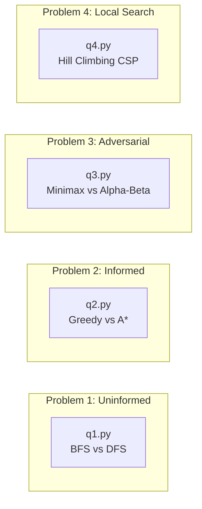

# Artificial Intelligence: Search & Optimization Master Repository
**Course:** Artificial Intelligence | **Spring 2026**  
**Group Assignment 01:** Uninformed Search, Informed Heuristic Search, Adversarial Search & Local Optimization

---

## 🌟 Repository Overview

This repository contains full Python implementations, comprehensive empirical reports, high-resolution visual evidence, and a deep-dive educational learning guide for fundamental AI search and optimization algorithms.

### 📚 Core Documents
1. **[LEARNING_GUIDE.md](file:///home/harshal/course/ai/Group_assignement/LEARNING_GUIDE.md)**: A complete, concentrated textbook-grade learning guide explaining every single concept, mathematical proof, data structure nuance, Mermaid diagram, and theoretical analysis required by this assignment.
2. **[REPORT.md](file:///home/harshal/course/ai/Group_assignement/REPORT.md)**: The official submission report containing detailed problem formulations, test case traces, execution metrics, comparative analysis tables, and embedded high-resolution screenshots.
3. **[REPORT_groupa.pdf](file:///home/harshal/course/ai/Group_assignement/REPORT_groupa.pdf)**: Compiled publication-quality PDF report ready for submission.

---

## 🧩 Problem Breakdown & Quick Run Commands



### 1. Problem 1: Rescue Robot Grid Search (BFS & DFS)
- **Source Code:** [q1.py](file:///home/harshal/course/ai/Group_assignement/q1.py)
- **Concepts:** Uninformed search, FIFO queue vs LIFO stack, level-by-level wavefront vs branch exploration, reverse-pushing stack rule.
- **Run Sample 1 (Path Found):**
  ```bash
  python3 q1.py << 'EOF'
  5 5
  S..#.
  #..#.
  .....
  .##..
  ....G
  EOF
  ```
- **Run Sample 2 (Path Blocked):**
  ```bash
  python3 q1.py << 'EOF'
  5 5
  S....
  ####.
  ....#
  .####
  ....G
  EOF
  ```

---

### 2. Problem 2: Campus Graph Route Finding (Greedy Best-First & $A^*$)
- **Source Code:** [q2.py](file:///home/harshal/course/ai/Group_assignement/q2.py)
- **Counterexample Test Case:** [p2_test_case_2.txt](file:///home/harshal/course/ai/Group_assignement/p2_test_case_2.txt)
- **Concepts:** Heuristic evaluation $h(n)$, admissibility, consistency/monotonicity, triangle inequality, myopic greed vs balanced cost $g(n) + h(n)$.
- **Run Sample 1 (Campus Graph):**
  ```bash
  python3 q2.py << 'EOF'
  6 7
  A B 4
  A C 2
  B D 5
  C D 3
  C E 6
  D E 3
  EF2
  AF
  A 7
  B 8
  C 5
  D 4
  E 2
  F 0
  EOF
  ```
- **Run Sample 2 (Greedy Suboptimality Counterexample):**
  ```bash
  python3 q2.py < p2_test_case_2.txt
  ```

---

### 3. Problem 3: Robot Strategy Battle (Minimax & Alpha-Beta)
- **Source Code:** [q3.py](file:///home/harshal/course/ai/Group_assignement/q3.py)
- **Concepts:** Two-player zero-sum games, game trees, backward induction, depth-limited heuristic evaluation, $\alpha$-$\beta$ pruning bounds, move ordering optimization ($\mathcal{O}(b^d) \to \mathcal{O}(b^{d/2})$).
- **Run Sample 1 (Search Depth 5):**
  ```bash
  python3 q3.py << 'EOF'
  5 7
  A.E.#..
  .#..#E.
  ...#...
  #E#..#.
  ....E.B
  MAX
  5
  EOF
  ```
- **Run Sample 2 (Search Depth 4):**
  ```bash
  python3 q3.py << 'EOF'
  5 7
  A...E..
  .###...
  ..E....
  ...###.
  .E...B.
  MAX
  4
  EOF
  ```

---

### 4. Problem 4: Exam Timetable Optimization (Local Search)
- **Source Code:** [q4.py](file:///home/harshal/course/ai/Group_assignement/q4.py)
- **Concepts:** Constraint Satisfaction Problems (CSP), complete-state representation, steepest-ascent hill climbing, $N \times (S-1) = 18$ neighborhood generation, local minima, plateaus, random restarts, simulated annealing.
- **Run Experiment 1 (`[1, 1, 2, 3, 4, 2]`):**
  ```bash
  python3 q4.py << 'EOF'
  6 4
  8
  1 2
  1 3
  2 4
  2 5
  3 4
  3 6
  4 5
  5 6
  1 1 2 3 4 2
  EOF
  ```

---

## 📸 Automated Terminal Screenshot Generator
All terminal executions can be automatically executed and captured into crisp PNG images via [generate_screenshots.py](file:///home/harshal/course/ai/Group_assignement/generate_screenshots.py):
```bash
python3 generate_screenshots.py
```
Generated artifacts are saved inside the `screenshots/` directory.

---

## 📖 For In-Depth Theory & Concept Mastery
Open and read **[LEARNING_GUIDE.md](file:///home/harshal/course/ai/Group_assignement/LEARNING_GUIDE.md)** for:
- Mathematical proofs of $A^*$ optimality and consistency.
- Step-by-step tracing of why Greedy search falls into cost traps.
- Derivation of Alpha-Beta pruning inequalities ($\alpha \ge \beta$).
- Comparison between path-finding and state-finding local optimization.
- Self-check quiz with interview & exam-level questions.
