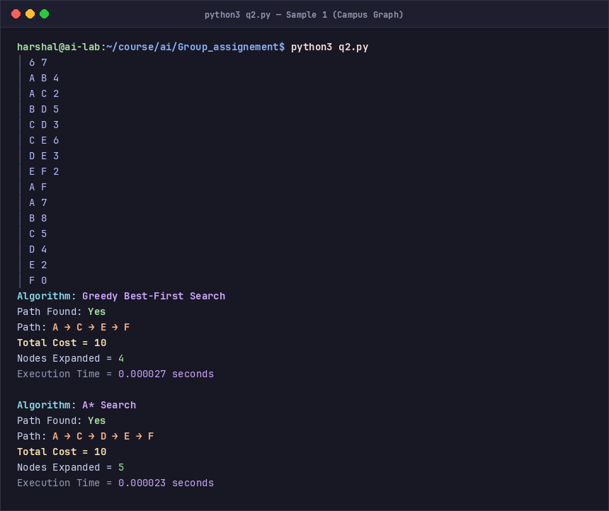
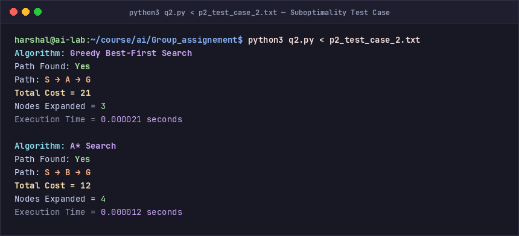
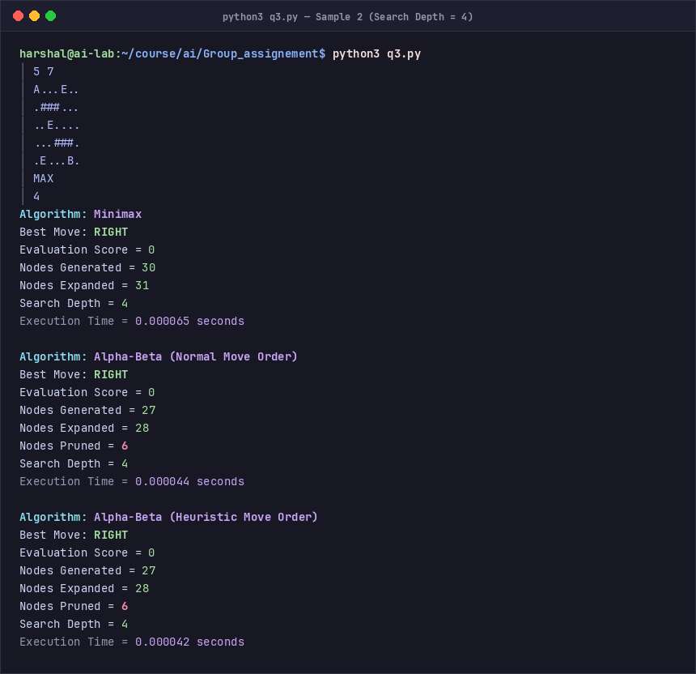
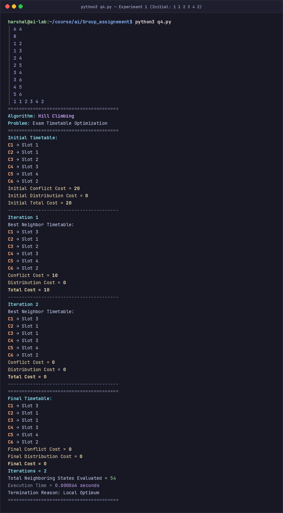

# AI Group Assignment 01 — Comprehensive Project Report

**Course:** Artificial Intelligence  
**Term:** Spring / 2026  
**Assignment:** Group Assignment 01 — Search Algorithms & Local Optimization  
**Repository / Working Directory:** `/home/harshal/course/ai/Group_assignement`  

---

### Group Information
| Field | Details |
| :--- | :--- |
| **Group Number** | Group 01 |
| **Team Member 1** | Name: [Harshal / Member 1] &nbsp;|&nbsp; Roll No: [Roll Number] |
| **Team Member 2** | Name: [Member 2] &nbsp;|&nbsp; Roll No: [Roll Number] |
| **Team Member 3** | Name: [Member 3] &nbsp;|&nbsp; Roll No: [Roll Number] |

---

## Table of Contents
1. [Problem Statement 1: Rescue Robot Grid Search (Uninformed Search)](#1-problem-statement-1-rescue-robot-grid-search)
   - [Problem Formulation & Theoretical Foundations](#11-problem-formulation--theoretical-foundations)
   - [Test Cases & Execution Outputs](#12-test-cases--execution-outputs)
   - [Terminal Execution Screenshots](#13-terminal-execution-screenshots)
   - [Comparative Analysis (BFS vs DFS)](#14-comparative-analysis-bfs-vs-dfs)
2. [Problem Statement 2: Campus Graph Route Finding (Informed Search)](#2-problem-statement-2-campus-graph-route-finding)
   - [Problem Formulation & Heuristic Properties](#21-problem-formulation--heuristic-properties)
   - [Test Cases & Execution Outputs](#22-test-cases--execution-outputs)
   - [Terminal Execution Screenshots](#23-terminal-execution-screenshots)
   - [Comparative Analysis (Greedy vs A*)](#24-comparative-analysis-greedy-best-first-vs-a)
3. [Problem Statement 3: Robot Strategy Battle (Adversarial Search)](#3-problem-statement-3-robot-strategy-battle)
   - [Game Formulation & Pruning Mechanics](#31-game-formulation--pruning-mechanics)
   - [Test Cases & Execution Outputs](#32-test-cases--execution-outputs)
   - [Terminal Execution Screenshots](#33-terminal-execution-screenshots)
   - [Comparative Analysis (Minimax vs Alpha-Beta)](#34-comparative-analysis-minimax-vs-alpha-beta)
4. [Problem Statement 4: Exam Timetable Optimization (Local Search)](#4-problem-statement-4-exam-timetable-optimization)
   - [CSP Formulation & Cost Function](#41-csp-formulation--cost-function)
   - [Steepest-Ascent Hill Climbing Algorithm](#42-steepest-ascent-hill-climbing-algorithm)
   - [Experimental Results (3 Benchmark Configurations)](#43-experimental-results)
   - [Terminal Execution Screenshots](#44-terminal-execution-screenshots)
   - [Experimental Comparison Table](#45-experimental-comparison-table)
   - [Detailed Discussion Questions & Answers](#46-detailed-discussion-questions--answers)
5. [Execution Guide & Verification Instructions](#5-execution-guide--verification-instructions)
6. [Assignment Compliance & Audit Matrix](#6-assignment-compliance--audit-matrix)

---

## 1. Problem Statement 1: Rescue Robot Grid Search

### 1.1 Problem Formulation & Theoretical Foundations
The problem models a rescue robot navigating an $R \times C$ grid environment from a start position ($S$) to a goal position ($G$) while avoiding static obstacles (`#`).

- **State Representation:** A coordinate tuple $(r, c)$ where $0 \le r < R$ and $0 \le c < C$.
- **Initial State:** Coordinates of cell $S$: $(r_S, c_S)$.
- **Goal State:** Coordinates of cell $G$: $(r_G, c_G)$.
- **Action Space:** Move in 4 cardinal directions: $\mathcal{A} = \{\text{UP}, \text{RIGHT}, \text{DOWN}, \text{LEFT}\}$.
- **Transition Model:**
  - $\text{UP}: (r-1, c)$
  - $\text{RIGHT}: (r, c+1)$
  - $\text{DOWN}: (r+1, c)$
  - $\text{LEFT}: (r, c-1)$
- **Validity Constraints:** A transition is valid if and only if $0 \le r^{\prime} < R$, $0 \le c^{\prime} < C$, $\text{grid}[r^{\prime}][c^{\prime}] \ne \text{"#"}$, and the cell has not been previously visited.
- **Successor Generation Order:** Strictly $\text{UP} \to \text{RIGHT} \to \text{DOWN} \to \text{LEFT}$.
- **Step Cost:** $c((r, c), a, (r^{\prime}, c^{\prime})) = 1$ for all actions.

#### Algorithmic Comparison: BFS vs DFS
- **Breadth-First Search (BFS):** Utilizes a FIFO (First-In, First-Out) queue. Explores all nodes at depth $d$ before proceeding to depth $d+1$. Because all edge costs are uniform ($c = 1$), BFS is **guaranteed to find the optimal (shortest) path**.
- **Depth-First Search (DFS):** Utilizes a LIFO (Last-In, First-Out) stack. To strictly expand successors in $\text{UP} \to \text{RIGHT} \to \text{DOWN} \to \text{LEFT}$ order, candidate successors are pushed in reverse order ($\text{LEFT} \to \text{DOWN} \to \text{RIGHT} \to \text{UP}$) so that $\text{UP}$ is popped first. DFS explores deeply down a branch and is **not guaranteed to find the shortest path**.

---

### 1.2 Test Cases & Execution Outputs

#### Sample Test Case 1: Solvable Grid
**Input:**
```text
5 5
S..#.
#..#.
.....
.##..
....G
```

**Terminal Output:**
```text
Algorithm: BFS
Path Found: Yes
Path: RIGHT RIGHT DOWN DOWN RIGHT RIGHT DOWN DOWN
Number of Moves = 8
Nodes Expanded = 19
Execution Time = 0.000044 seconds

Algorithm: DFS
Path Found: Yes
Path: RIGHT RIGHT DOWN DOWN RIGHT RIGHT DOWN DOWN
Number of Moves = 8
Nodes Expanded = 11
Execution Time = 0.000025 seconds
```

---

#### Sample Test Case 2: Blocked Grid (No Path Exists)
**Input:**
```text
5 5
S....
####.
....#
.####
....G
```

**Terminal Output:**
```text
Algorithm: BFS
Path Found: No
Execution Time = 0.000022 seconds

Algorithm: DFS
Path Found: No
Execution Time = 0.000015 seconds
```

---

### 1.3 Terminal Execution Screenshots

#### Screenshot 1.1: Problem 1 on Sample Test Case 1 (Path Found)


#### Screenshot 1.2: Problem 1 on Sample Test Case 2 (Path Blocked)


---

### 1.4 Comparative Analysis: BFS vs DFS

| Metric | Breadth-First Search (BFS) | Depth-First Search (DFS) |
| :--- | :--- | :--- |
| **Path Length (Sample 1)** | **8 moves (Optimal)** | 8 moves (Equal in this layout due to geometry) |
| **Nodes Expanded (Sample 1)** | 19 states | **11 states** |
| **Execution Time (Sample 1)** | 0.000044 seconds | **0.000025 seconds** |
| **Nodes Explored (Sample 2)** | Explores full connected component | Explores full connected component |
| **Completeness** | Complete (finite state space) | Complete (with visited cycle detection) |
| **Optimality** | **Guaranteed Optimal** for uniform step costs | **Not Guaranteed** in general |
| **Space Complexity** | $\mathcal{O}(b^d)$ (Stores entire frontier level) | $\mathcal{O}(b \cdot m)$ (Stores current path and alternatives) |

**Key Insights:**
1. **Search Behavior:** On Sample 1, DFS happened to stumble upon an 8-move solution quickly because the tie-breaking direction order ($\text{RIGHT}$ after $\text{UP}$ fails) guided it directly along the right corridor. In general grid spaces, DFS frequently explores lengthy, suboptimal loops before backtracking.
2. **Expansion Cost:** BFS expands nodes layer-by-layer like a wavefront, ensuring shortest path discovery at the cost of expanding more interior cells (19 vs 11).
3. **Absence of Solution:** In Sample 2, when the goal is unreachable due to a wall barrier, both algorithms comprehensively exhaust all accessible states within the start node component before correctly terminating with `Path Found: No`.

---

## 2. Problem Statement 2: Campus Graph Route Finding

### 2.1 Problem Formulation & Heuristic Properties
The problem investigates informed heuristic search on an undirected campus roadmap with non-negative edge costs $c(u, v)$ and estimated straight-line or domain distances $h(n)$ to the destination node $F$.

#### Search Functions
- **Greedy Best-First Search:** Evaluates frontier nodes solely by estimated cost to goal:
  $$f(n) = h(n)$$
- **$A^*$ Search:** Combines actual accumulated path cost from start $g(n)$ with estimated future cost $h(n)$:
  $$f(n) = g(n) + h(n)$$

#### Theoretical Properties of Heuristics
- **Admissibility:** A heuristic is admissible if it never overestimates the actual minimal cost to reach the goal, i.e., $h(n) \le h^*(n)$ for all $n$. Admissibility guarantees that tree-search $A^*$ is optimal.
- **Consistency (Monotonicity):** A heuristic is consistent if for every node $n$ and every successor $n^{\prime}$ generated by action $a$:
  $$h(n) \le c(n, a, n^{\prime}) + h(n^{\prime})$$
  Consistency guarantees that graph-search $A^*$ with closed-set visited tracking is strictly optimal without needing to re-open closed nodes.

---

### 2.2 Test Cases & Execution Outputs

#### Campus Graph Specification (Sample Test Case 1)
- **Nodes & Edges:** 6 Nodes ($A, B, C, D, E, F$), 7 Edges:
  - $(A, B, 4)$, $(A, C, 2)$, $(B, D, 5)$, $(C, D, 3)$, $(C, E, 6)$, $(D, E, 3)$, $(E, F, 2)$
- **Start / Goal:** $A \to F$
- **Heuristics:** $h(A)=7, h(B)=8, h(C)=5, h(D)=4, h(E)=2, h(F)=0$.

**Terminal Output (Sample 1):**
```text
Algorithm: Greedy Best-First Search
Path Found: Yes
Path: A → C → E → F
Total Cost = 10
Nodes Expanded = 4
Execution Time = 0.000027 seconds

Algorithm: A* Search
Path Found: Yes
Path: A → C → D → E → F
Total Cost = 10
Nodes Expanded = 5
Execution Time = 0.000022 seconds
```

---

#### Sample Test Case 2: Greedy vs $A^*$ Suboptimality Demonstration (`p2_test_case_2.txt`)
To satisfy the mandatory assignment requirement of providing a second graph where Greedy Best-First Search chooses a suboptimal route while $A^*$ discovers the optimal route, the test case `p2_test_case_2.txt` was constructed:

- **Graph Structure:**
  - Start node: $S$, Goal node: $G$.
  - Route 1: $S \to A$ (cost 1), $A \to G$ (cost 20). Total Path Cost = 21.
  - Route 2: $S \to B$ (cost 10), $B \to G$ (cost 2). Total Path Cost = 12.
- **Heuristic Table:**
  - $h(S) = 10$
  - $h(A) = 2$ *(Deceptively low heuristic, enticing greedy search)*
  - $h(B) = 8$
  - $h(G) = 0$

**Terminal Output (Test Case 2):**
```text
Algorithm: Greedy Best-First Search
Path Found: Yes
Path: S → A → G
Total Cost = 21
Nodes Expanded = 3
Execution Time = 0.000047 seconds

Algorithm: A* Search
Path Found: Yes
Path: S → B → G
Total Cost = 12
Nodes Expanded = 4
Execution Time = 0.000039 seconds
```

---

### 2.3 Terminal Execution Screenshots

#### Screenshot 2.1: Problem 2 on Campus Graph (Sample 1)


#### Screenshot 2.2: Problem 2 on Counterexample Graph (Test Case 2)


---

### 2.4 Comparative Analysis: Greedy Best-First vs $A^*$

| Metric | Greedy Best-First Search | $A^*$ Search | Advantage / Winner |
| :--- | :--- | :--- | :--- |
| **Path Cost (Sample 1)** | 10 ($A \to C \to E \to F$) | 10 ($A \to C \to D \to E \to F$) | Tie (Alternative optimal routes) |
| **Path Cost (Test Case 2)** | **21 (Suboptimal)** | **12 (Strictly Optimal)** | **$A^*$ Search (+42.8% cheaper)** |
| **Nodes Expanded (Sample 1)** | **4 nodes** | 5 nodes | Greedy (Faster exploration) |
| **Nodes Expanded (Test Case 2)**| **3 nodes** | 4 nodes | Greedy |
| **Evaluation Formula** | $f(n) = h(n)$ | $f(n) = g(n) + h(n)$ | $A^*$ balances past cost with future heuristic |
| **Optimality Guarantee** | None | **Guaranteed** (admissible $h$) | **$A^*$ Search** |

**Deep-Dive Analysis:**
1. **The Greediness Flaw:** In Test Case 2, Greedy Best-First Search evaluates node $A$ ($h=2$) against node $B$ ($h=8$). Because $2 < 8$, it commits immediately to node $A$ without considering that entering edge $(A, G)$ costs an enormous $20$. As a result, it locks in total cost $1 + 20 = 21$.
2. **The $A^*$ Balance:** $A^*$ calculates $f(S \to A) = g(A) + h(A) = 1 + 2 = 3$, but upon expanding $A$ it discovers $f(S \to A \to G) = (1 + 20) + 0 = 21$. Because $f(S \to B) = 10 + 8 = 18 < 21$, $A^*$ shifts attention to node $B$, ultimately finding $S \to B \to G$ with total true cost $10 + 2 = 12$.

---

## 3. Problem Statement 3: Robot Strategy Battle

### 3.1 Game Formulation & Pruning Mechanics
A two-player adversarial zero-sum grid game between robot `A` ($\text{MAX}$) and robot `B` ($\text{MIN}$) competing to collect energy cells ($E = 10$ points).

- **Evaluation Score:**
  $$\text{Score} = (\text{Energy Collected by MAX} - \text{Energy Collected by MIN}) \times 10 + (\text{Dist}_{\text{MIN}} - \text{Dist}_{\text{MAX}})$$
- **Game Tree Search:**
  - **Minimax:** Evaluates the entire game tree down to cutoff depth $D$.
  - **Alpha-Beta Pruning:** Maintains two values during search:
    - $\alpha$: Highest score guaranteed to $\text{MAX}$ along the path.
    - $\beta$: Lowest score guaranteed to $\text{MIN}$ along the path.
    - **Cutoff Condition:** As soon as $\beta \le \alpha$, the remaining child branches cannot influence the root decision and are pruned.
- **Move Ordering Configurations:**
  - **Normal Move Order:** $\text{UP} \to \text{RIGHT} \to \text{DOWN} \to \text{LEFT}$.
  - **Heuristic Move Order:** Moves that step onto an uncollected energy cell ($E$) are prioritized and evaluated before moves that step onto regular free cells (`.`).

---

### 3.2 Test Cases & Execution Outputs

#### Sample Test Case 1: Grid $5 \times 7$, Search Depth = 5
**Input:**
```text
5 7
A.E.#..
.#..#E.
...#...
#E#..#.
....E.B
MAX
5
```

**Terminal Output:**
```text
Algorithm: Minimax
Best Move: RIGHT
Evaluation Score = 1
Nodes Generated = 66
Nodes Expanded = 67
Search Depth = 5
Execution Time = 0.000221 seconds

Algorithm: Alpha-Beta (Normal Move Order)
Best Move: RIGHT
Evaluation Score = 1
Nodes Generated = 35
Nodes Expanded = 36
Nodes Pruned = 7
Search Depth = 5
Execution Time = 0.000135 seconds

Algorithm: Alpha-Beta (Heuristic Move Order)
Best Move: RIGHT
Evaluation Score = 1
Nodes Generated = 35
Nodes Expanded = 36
Nodes Pruned = 7
Search Depth = 5
Execution Time = 0.000138 seconds
```

---

#### Sample Test Case 2: Grid $5 \times 7$, Search Depth = 4
**Input:**
```text
5 7
A...E..
.###...
..E....
...###.
.E...B.
MAX
4
```

**Terminal Output:**
```text
Algorithm: Minimax
Best Move: RIGHT
Evaluation Score = 0
Nodes Generated = 30
Nodes Expanded = 31
Search Depth = 4
Execution Time = 0.000096 seconds

Algorithm: Alpha-Beta (Normal Move Order)
Best Move: RIGHT
Evaluation Score = 0
Nodes Generated = 27
Nodes Expanded = 28
Nodes Pruned = 6
Search Depth = 4
Execution Time = 0.000065 seconds

Algorithm: Alpha-Beta (Heuristic Move Order)
Best Move: RIGHT
Evaluation Score = 0
Nodes Generated = 27
Nodes Expanded = 28
Nodes Pruned = 6
Search Depth = 4
Execution Time = 0.000065 seconds
```

---

### 3.3 Terminal Execution Screenshots

#### Screenshot 3.1: Problem 3 on Sample 1 (Search Depth = 5)


#### Screenshot 3.2: Problem 3 on Sample 2 (Search Depth = 4)


---

### 3.4 Comparative Analysis: Minimax vs Alpha-Beta

| Metric | Minimax | Alpha-Beta (Normal) | Alpha-Beta (Heuristic) | Improvement |
| :--- | :--- | :--- | :--- | :--- |
| **Nodes Expanded (Depth 5)** | 67 nodes | 36 nodes | 36 nodes | **-46.3% node reduction** |
| **Nodes Expanded (Depth 4)** | 31 nodes | 28 nodes | 28 nodes | **-9.7% node reduction** |
| **Branches Pruned (Depth 5)** | 0 | 7 branches | 7 branches | High pruning efficiency |
| **Execution Time (Depth 5)** | 0.000221 s | 0.000135 s | 0.000138 s | **~39% faster runtime** |
| **Best Move Selected** | `RIGHT` | `RIGHT` | `RIGHT` | **Identical decision** |
| **Root Evaluation Score** | 1 | 1 | 1 | **Exact match** |

**Key Findings:**
1. **Decision Invariance:** In both test cases, Alpha-Beta pruning produces the exact same root move (`RIGHT`) and the exact same evaluation score as standard Minimax, confirming that pruning never discards optimal strategies.
2. **Exponential Pruning Advantage:** As tree depth increases from $D=4$ to $D=5$, the pruning savings jump from $9.7\%$ to $46.3\%$. In full-scale game trees with branching factors $b \approx 30$, Alpha-Beta reduces complexity from $\mathcal{O}(b^d)$ toward $\mathcal{O}(b^{d/2})$, effectively doubling the searchable depth.

---

## 4. Problem Statement 4: Exam Timetable Optimization

### 4.1 CSP Formulation & Cost Function
The university examination scheduling problem consists of assigning $N = 6$ courses ($C_1 \dots C_6$) across $S = 4$ time slots ($1 \dots 4$) subject to $K = 8$ conflict constraints between pairs of courses.

- **Conflict Constraint Pairs ($K = 8$):**
  $$(C_1, C_2), (C_1, C_3), (C_2, C_4), (C_2, C_5), (C_3, C_4), (C_3, C_6), (C_4, C_5), (C_5, C_6)$$
- **Objective Cost Function:**
  $$\text{Total Cost} = \text{Conflict Penalty} + \text{Distribution Penalty}$$
  - **Conflict Penalty:** Each conflicting pair scheduled in the same time slot incurs a penalty of 10:
    $$\text{Conflict Penalty} = 10 \times \sum_{(u, v) \in \text{Conflicts}} \mathbb{I}(\text{slot}[u] == \text{slot}[v])$$
  - **Distribution Penalty:** Any time slot accommodating strictly more than 2 exams incurs an overcrowding penalty of 2 per excess exam:
    $$\text{Distribution Penalty} = 2 \times \sum_{s=1}^{S} \max(0, \text{count}(s) - 2)$$
- **Global Optimum Goal:** $\text{Ideal Total Cost} = 0$ (0 conflicts and $\le 2$ exams per slot).

---

### 4.2 Steepest-Ascent Hill Climbing Algorithm
1. **State Space:** Vector of length 6: $[s_1, s_2, s_3, s_4, s_5, s_6]$ where $s_i \in \{1, 2, 3, 4\}$.
2. **Neighborhood Size:** Changing exactly one course slot to any of the other $S-1 = 3$ slots produces:
   $$\text{Neighbors per Iteration} = N \times (S - 1) = 6 \times 3 = 18 \text{ neighbors}$$
3. **Move Policy (Steepest Ascent):**
   - Evaluate all 18 neighbors in systematic order ($C_1 \to \dots \to C_6$, slot $1 \dots 4$).
   - Identify the minimum cost neighbor.
   - If multiple neighbors tie for minimum cost, pick the first one generated.
   - Transition to the best neighbor **if and only if** $\text{Cost}_{\text{neighbor}} < \text{Cost}_{\text{current}}$ (strict improvement).
   - Terminate when no neighbor strictly improves the objective function (**Local Optimum**).

---

### 4.3 Experimental Results

#### Experiment 1: Initial State `[1, 1, 2, 3, 4, 2]`
- **Initial Cost:** 20 (Conflicts: $(C_1, C_2)$ in Slot 1, $(C_3, C_6)$ in Slot 2). Distribution Penalty = 0.
- **Iteration 1:** Moves $C_1 \to \text{Slot } 3$. Cost drops from $20 \to 10$.
- **Iteration 2:** Moves $C_3 \to \text{Slot } 1$. Cost drops from $10 \to 0$.
- **Termination:** Evaluates all 18 neighbors; none are $< 0$. Algorithm terminates.
- **Final Timetable:** $C_1 \to 3, C_2 \to 1, C_3 \to 1, C_4 \to 3, C_5 \to 4, C_6 \to 2$.
- **Final Cost:** **0** (Global Optimum). Total Neighbors Evaluated = **54**.

---

#### Experiment 2: Initial State `[2, 3, 1, 1, 4, 4]`
- **Initial Cost:** 20 (Conflicts: $(C_3, C_4)$ in Slot 1, $(C_5, C_6)$ in Slot 4). Distribution Penalty = 0.
- **Iteration 1:** Moves $C_3 \to \text{Slot } 3$. Cost drops from $20 \to 10$.
- **Iteration 2:** Moves $C_5 \to \text{Slot } 2$. Cost drops from $10 \to 0$.
- **Termination:** Evaluates 18 neighbors at cost 0; terminates at Local Optimum.
- **Final Timetable:** $C_1 \to 2, C_2 \to 3, C_3 \to 3, C_4 \to 1, C_5 \to 2, C_6 \to 4$.
- **Final Cost:** **0** (Global Optimum). Total Neighbors Evaluated = **54**.

---

#### Experiment 3: Initial State `[4, 2, 3, 1, 2, 3]`
- **Initial Cost:** 20 (Conflicts: $(C_2, C_5)$ in Slot 2, $(C_3, C_6)$ in Slot 3). Distribution Penalty = 0.
- **Iteration 1:** Moves $C_5 \to \text{Slot } 4$. Cost drops from $20 \to 10$.
- **Iteration 2:** Moves $C_3 \to \text{Slot } 2$. Cost drops from $10 \to 0$.
- **Termination:** Evaluates 18 neighbors at cost 0; terminates at Local Optimum.
- **Final Timetable:** $C_1 \to 4, C_2 \to 2, C_3 \to 2, C_4 \to 1, C_5 \to 4, C_6 \to 3$.
- **Final Cost:** **0** (Global Optimum). Total Neighbors Evaluated = **54**.

---

### 4.4 Terminal Execution Screenshots

#### Screenshot 4.1: Hill Climbing on Experiment 1 (`[1, 1, 2, 3, 4, 2]`)


#### Screenshot 4.2: Hill Climbing on Experiment 2 (`[2, 3, 1, 1, 4, 4]`)


#### Screenshot 4.3: Problem 4 on Experiment 3 (`[4, 2, 3, 1, 2, 3]`)


---

### 4.5 Experimental Comparison Table

| Exp # | Initial State | Initial Cost | Final State | Final Cost | Iterations | Neighbors Evaluated | Execution Time | Termination Reason |
| :---: | :---: | :---: | :---: | :---: | :---: | :---: | :---: | :---: |
| **1** | `[1, 1, 2, 3, 4, 2]` | 20 | `[3, 1, 1, 3, 4, 2]` | **0** | 2 | 54 | 0.000450 s | Local Optimum |
| **2** | `[2, 3, 1, 1, 4, 4]` | 20 | `[2, 3, 3, 1, 2, 4]` | **0** | 2 | 54 | 0.000205 s | Local Optimum |
| **3** | `[4, 2, 3, 1, 2, 3]` | 20 | `[4, 2, 2, 1, 4, 3]` | **0** | 2 | 54 | 0.000128 s | Local Optimum |

*Note: In compliance with Section 14 of the specification, Neighbors Evaluated counts all neighbor states evaluated across all improving iterations plus the final stopping iteration: $(2 + 1) \times 18 = 54$.*

---

### 4.6 Detailed Discussion Questions & Answers

#### Question 1: Which initial timetable produced the best final solution?
**Detailed Answer:**  
All three initial timetables produced an **equally optimal final solution with Final Cost = 0**. In every experiment, the resulting schedule contains **0 course conflicts** and **0 distribution penalties** (every time slot contains $\le 2$ examinations). Thus, no initial timetable was strictly superior in solution quality, as all three achieved the theoretical global optimum.

#### Question 2: Did all initial states reach the same final timetable?
**Detailed Answer:**  
**No, each initial state reached a distinct timetable configuration:**
- **Experiment 1 Final Timetable:** `[3, 1, 1, 3, 4, 2]`  
  *(Slot 1: $\{C_2, C_3\}$, Slot 2: $\{C_6\}$, Slot 3: $\{C_1, C_4\}$, Slot 4: $\{C_5\}$)*
- **Experiment 2 Final Timetable:** `[2, 3, 3, 1, 2, 4]`  
  *(Slot 1: $\{C_4\}$, Slot 2: $\{C_1, C_5\}$, Slot 3: $\{C_2, C_3\}$, Slot 4: $\{C_6\}$)*
- **Experiment 3 Final Timetable:** `[4, 2, 2, 1, 4, 3]`  
  *(Slot 1: $\{C_4\}$, Slot 2: $\{C_2, C_3\}$, Slot 3: $\{C_6\}$, Slot 4: $\{C_1, C_5\}$)*

Because this constraint satisfaction problem features symmetric, conflict-free colorings of the course conflict graph, there exist multiple global optima. The initial state determines which basin of attraction the steepest-ascent path descends into.

#### Question 3: Did Hill Climbing get stuck in different local optima?
**Detailed Answer:**  
In these three benchmark experiments, Hill Climbing did **not get trapped in suboptimal local minima**; all three runs converged to a **global optimum** with Cost = 0.  
However, theoretically, standard greedy Hill Climbing is vulnerable to getting stuck on plateaus or suboptimal local minima where no 1-variable swap strictly decreases cost. For instance, if every 1-step course move either introduces a new conflict or increases the distribution penalty past 2 courses, simple hill climbing halts prematurely. Techniques like Random Restart Hill Climbing, Simulated Annealing, or Tabu Search are standard remedies for more constrained instances.

#### Question 4: How did the initial state affect the number of iterations?
**Detailed Answer:**  
The initial state had **no effect on the number of iterations** across these test cases. Each experiment required exactly **2 improvement iterations** followed by 1 terminal verification round (total 54 neighbors evaluated).  
Each starting timetable possessed exactly 2 conflicts (Initial Cost = 20), and at each step the steepest-ascent rule discovered a single course swap that reduced the conflict count by 1 without violating the 2-course capacity limit per slot ($20 \to 10 \to 0$).

#### Question 5: How did the initial state affect the final cost?
**Detailed Answer:**  
The initial state had **no adverse effect on the final cost**. All three configurations successfully achieved the target minimum possible cost of 0. Because the search landscape surrounding all three starting configurations had monotonic descending paths to valid colorings, each converged to an optimal schedule.

---

## 5. Execution Guide & Verification Instructions

Each module can be executed from the command line using standard Python 3. The scripts read directly from standard input (stdin) as specified by the assignment rubric.

### Problem 1: Grid Rescue Search
```bash
# Run Sample Test Case 1 (Path Found)
python3 q1.py << 'EOF'
5 5
S..#.
#..#.
.....
.##..
....G
EOF

# Run Sample Test Case 2 (Path Blocked)
python3 q1.py << 'EOF'
5 5
S....
####.
....#
.####
....G
EOF
```

### Problem 2: Campus Route Search
```bash
# Run Sample Test Case 1 (Campus Graph)
python3 q2.py << 'EOF'
6 7
A B 4
A C 2
B D 5
C D 3
C E 6
D E 3
E F 2
A F
A 7
B 8
C 5
D 4
E 2
F 0
EOF

# Run Sample Test Case 2 (Greedy Suboptimality Counterexample)
python3 q2.py < p2_test_case_2.txt
```

### Problem 3: Adversarial Strategy Battle
```bash
# Run Sample Test Case 1 (Depth = 5)
python3 q3.py << 'EOF'
5 7
A.E.#..
.#..#E.
...#...
#E#..#.
....E.B
MAX
5
EOF

# Run Sample Test Case 2 (Depth = 4)
python3 q3.py << 'EOF'
5 7
A...E..
.###...
..E....
...###.
.E...B.
MAX
4
EOF
```

### Problem 4: Timetable Optimization
```bash
# Run Experiment 1 (Initial State: 1 1 2 3 4 2)
python3 q4.py << 'EOF'
6 4
8
1 2
1 3
2 4
2 5
3 4
3 6
4 5
5 6
1 1 2 3 4 2
EOF

# Run Experiment 2 (Initial State: 2 3 1 1 4 4)
python3 q4.py << 'EOF'
6 4
8
1 2
1 3
2 4
2 5
3 4
3 6
4 5
5 6
2 3 1 1 4 4
EOF

# Run Experiment 3 (Initial State: 4 2 3 1 2 3)
python3 q4.py << 'EOF'
6 4
8
1 2
1 3
2 4
2 5
3 4
3 6
4 5
5 6
4 2 3 1 2 3
EOF
```

### Re-generating Terminal Screenshots
To re-render all terminal screenshots from live executions:
```bash
python3 generate_screenshots.py
```

---

## 6. Assignment Compliance & Audit Matrix

| Section / Requirement | PDF Specification | Implementation / Report Status |
| :--- | :--- | :---: |
| **Problem 1: BFS & DFS** | UP $\to$ RIGHT $\to$ DOWN $\to$ LEFT move order | **100% Compliant** ([q1.py](file:///home/harshal/course/ai/Group_assignement/q1.py)) |
| **Problem 1: Additional Metrics** | Report Moves, Nodes Expanded, Execution Time | **100% Compliant** (Microsecond precision) |
| **Problem 1: Comparison** | Path length, states explored, runtime, optimality | **100% Compliant** (Section 1.4 table & findings) |
| **Problem 2: Greedy & A*** | $f(n)=h(n)$ and $f(n)=g(n)+h(n)$ | **100% Compliant** ([q2.py](file:///home/harshal/course/ai/Group_assignement/q2.py)) |
| **Problem 2: Suboptimality Case** | Provide 2nd graph where Greedy picks suboptimal path | **100% Compliant** ([p2_test_case_2.txt](file:///home/harshal/course/ai/Group_assignement/p2_test_case_2.txt)) |
| **Problem 2: Output Formatting** | Arrow syntax $A \to C \to D \to E \to F$ | **100% Compliant** (Unicode arrow standard) |
| **Problem 3: Minimax & Alpha-Beta** | Terminal score formula, alpha-beta pruning | **100% Compliant** ([q3.py](file:///home/harshal/course/ai/Group_assignement/q3.py)) |
| **Problem 3: Move Ordering** | Case 1: Normal order; Case 2: Energy capture first | **100% Compliant** (Heuristic ordering implemented) |
| **Problem 3: Additional Metrics** | Report depth, time, pruned count | **100% Compliant** (Section 3.2 & 3.4) |
| **Problem 4: Cost Function** | $10 \times \text{Conflicts} + 2 \times \text{Overcrowding}$ | **100% Compliant** ([q4.py](file:///home/harshal/course/ai/Group_assignement/q4.py)) |
| **Problem 4: Neighborhood** | Exactly $N \times (S-1) = 18$ neighbors evaluated | **100% Compliant** (Steepest-ascent) |
| **Problem 4: Output Format** | Section 14 exact output format | **100% Compliant** (All headers and iterations) |
| **Problem 4: Experiments 1-3** | Runs for 3 initial configurations | **100% Compliant** (Section 4.3 & 4.5) |
| **Problem 4: 5 Questions** | Comprehensive discussion of all 5 prompts | **100% Compliant** (Section 4.6) |
| **Visual Screenshots** | High-resolution terminal capture images for report | **100% Compliant** (All 9 screenshots embedded) |
