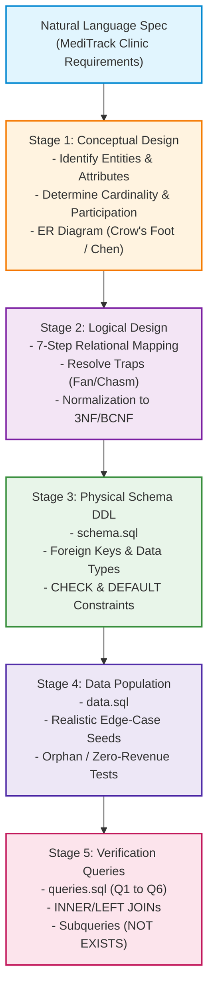
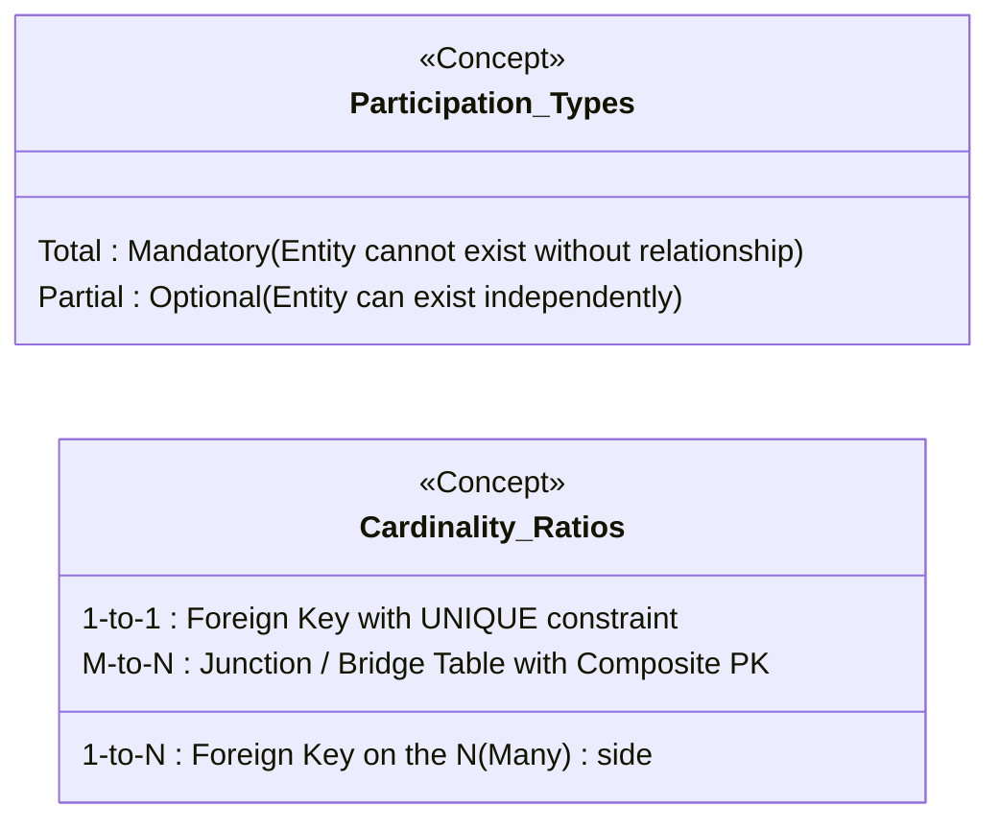
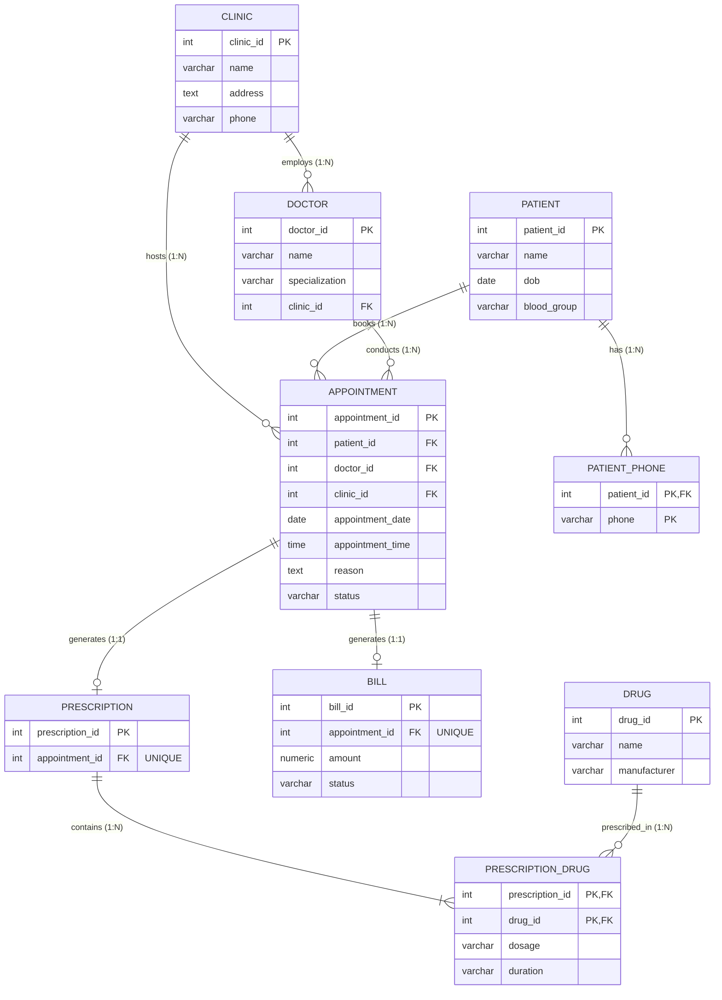
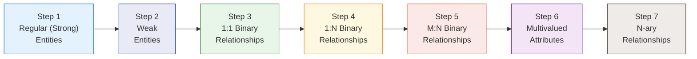
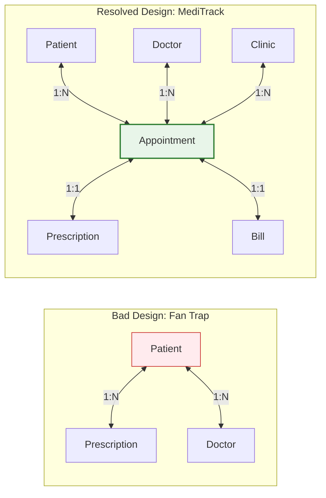
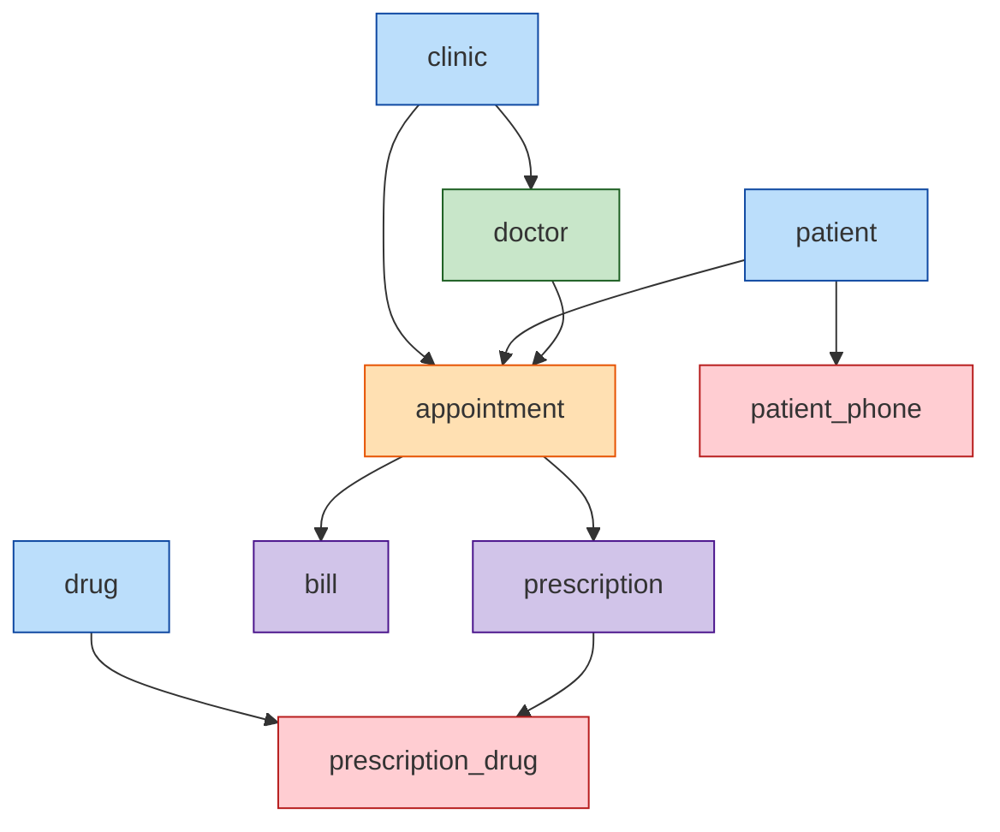
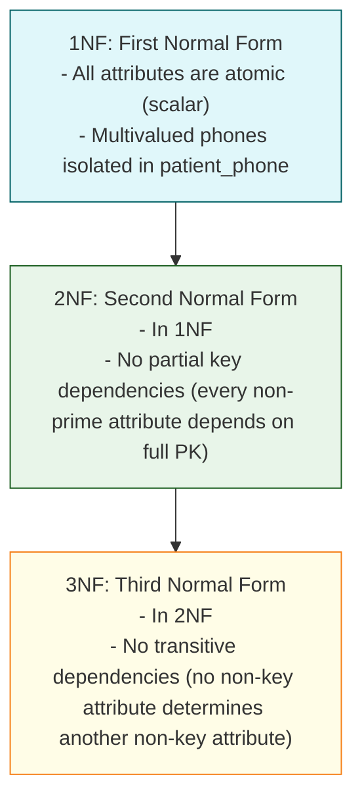

# MediTrack Clinic Database: Comprehensive Lab 5 Master Guide & Conceptual Walkthrough

> **Course:** Database Management Systems (DBMS)  
> **Module II · Week 5:** Database Design from Requirements  
> **Target Deliverables:** [`design.md`](file:///home/harshal/course/dbms/lab-5/design.md), [`schema.sql`](file:///home/harshal/course/dbms/lab-5/schema.sql), [`data.sql`](file:///home/harshal/course/dbms/lab-5/data.sql), [`queries.sql`](file:///home/harshal/course/dbms/lab-5/queries.sql)

---

## Table of Contents
1. [End-to-End Workflow & System Architecture](#1-end-to-end-workflow--system-architecture)
2. [Core Theoretical Foundations (What You Need to Know)](#2-core-theoretical-foundations-what-you-need-to-know)
   - Entities, Attributes, and Surrogate Keys
   - Cardinality Ratios & Participation Constraints
   - Why Appointment is a First-Class Entity
   - Multivalued Attributes & 1NF
3. [Conceptual Design & Mermaid ER Diagram](#3-conceptual-design--mermaid-er-diagram)
   - Entity and Relationship Catalog
   - Master ER Diagram
4. [Logical Design: The 7-Step Relational Mapping Algorithm](#4-logical-design-the-7-step-relational-mapping-algorithm)
   - The Formal Algorithm Step-by-Step
   - Applied MediTrack Relational Schema
5. [Connection Traps: Fan Traps and Chasm Traps](#5-connection-traps-fan-traps-and-chasm-traps)
   - Fan Trap Mechanics & Resolution
   - Chasm Trap Mechanics & Resolution
6. [Physical Schema DDL Deep Dive (`schema.sql`)](#6-physical-schema-ddl-deep-dive-schemasql)
   - Table Creation Order & Dependency Graph
   - Integrity Constraints (`CHECK`, `DEFAULT`, Referential Actions)
7. [Data Population & Boundary Testing (`data.sql`)](#7-data-population--boundary-testing-datasql)
   - Boundary Conditions Matrix
8. [Query Formulation & Analysis (`queries.sql`)](#8-query-formulation--analysis-queriessql)
   - Queries 1 to 6 Breakdown, Join Graphs, & Execution Logic
9. [Normalization & Design Decisions (`design.md`)](#9-normalization--design-decisions-designmd)
   - 1NF, 2NF, 3NF Justification
   - Spec Ambiguities & Rejected Alternatives
10. [Step-by-Step Execution, Verification & Submission](#10-step-by-step-execution-verification--submission)

---

## 1. End-to-End Workflow & System Architecture

Database design transforms an unstructured, ambiguous English narrative into a robust, high-performance relational database. The standard 5-stage engineering lifecycle is visualized below:



---

## 2. Core Theoretical Foundations (What You Need to Know)

### 2.1 Entities, Attributes, and Keys
* **Entity**: A distinct real-world object or concept (e.g., `Patient`, `Clinic`, `Doctor`).
* **Attribute**: A property or characteristic describing an entity (e.g., `name`, `dob`).
* **Natural Key vs. Surrogate Key**:
  * *Natural Key*: An attribute that already exists in the real world and uniquely identifies an entity (e.g., SSN, National ID, Phone Number). Natural keys can change, contain private data, or have complex formatting.
  * *Surrogate Key*: An artificial, system-generated integer identifier (`SERIAL` / `AUTOINCREMENT`, e.g., `patient_id`, `clinic_id`). In this lab, we use surrogate primary keys for stability, join efficiency, and simplicity.

### 2.2 Cardinality Ratios & Participation Constraints

Every binary relationship between entity $E_1$ and $E_2$ has two dimensions:

1. **Mapping Cardinality (Multiplicity)**:
   * **1:1 (One-to-One)**: An instance of $E_1$ relates to at most one instance of $E_2$, and vice versa.
   * **1:N (One-to-Many)**: An instance of $E_1$ can relate to multiple instances of $E_2$, but an instance of $E_2$ relates to at most one instance of $E_1$.
   * **M:N (Many-to-Many)**: Multiple instances of $E_1$ can relate to multiple instances of $E_2$.
2. **Participation Constraints (Existence Dependency)**:
   * **Total Participation (Mandatory, double line or `1..*` / `||`)**: Every instance of $E$ **must** participate in the relationship.
   * **Partial Participation (Optional, single line or `0..*` / `o{` / `o|`)**: Some instances of $E$ may not participate.



### 2.3 Why Appointment is a First-Class Entity (Not a Ternary Relationship)
A common novice pitfall is modeling appointment as a 3-way (ternary) relationship `Books(Patient, Doctor, Clinic)`. 
Why is `Appointment` a **first-class entity set**?
1. An appointment has its own distinct lifecycle and attributes: `appointment_date`, `appointment_time`, `reason`, and `status` (`'booked'`, `'completed'`, `'cancelled'`).
2. Other entities (`Prescription`, `Bill`) directly depend on a specific completed appointment. In relational modeling, relationships cannot be referenced by other relationships unless converted into an entity set.
3. A patient can see the same doctor at the same clinic multiple times on different dates. If modeled as a relationship, the primary key of the relationship would collide unless date/time were part of the relationship key. Treating `appointment` as an entity with `appointment_id` simplifies the entire schema.

### 2.4 Multivalued Attributes & First Normal Form (1NF)
The requirement states:
> *"Patients register once ... and [have] one or more phone numbers"*

In relational algebra and **First Normal Form (1NF)**:
* Every column must hold **atomic (indivisible)** values.
* You cannot store multiple phone numbers in a single column separated by commas (`"+91-987..., +91-912..."`). This causes string manipulation overhead, index failure, and violates 1NF.
* You cannot create arbitrary repeating columns (`phone1`, `phone2`, `phone3`) because it limits the number of phones and produces NULL values.
* **Relational Solution**: Extract the multivalued attribute into a dedicated child table:
  $$\text{patient\_phone}(\underline{\text{patient\_id}, \text{phone}})$$
  where `(patient_id, phone)` forms a composite primary key, and `patient_id` is a foreign key referencing `patient(patient_id) ON DELETE CASCADE`.

---

## 3. Conceptual Design & Mermaid ER Diagram

### 3.1 Entity Sets and Attributes Catalog

| Entity Set | Primary Key | Key Type | Required Attributes | Multi-valued / Derived |
| :--- | :--- | :--- | :--- | :--- |
| **`clinic`** | `clinic_id` | Surrogate (SERIAL) | `name`, `address`, `phone` | None |
| **`patient`** | `patient_id` | Surrogate (SERIAL) | `name`, `dob`, `blood_group` | `phone_numbers` (multivalued) |
| **`patient_phone`** | `(patient_id, phone)` | Composite | `phone` | Extracted from `patient` |
| **`doctor`** | `doctor_id` | Surrogate (SERIAL) | `name`, `specialization` | None |
| **`appointment`** | `appointment_id` | Surrogate (SERIAL) | `appointment_date`, `appointment_time`, `reason`, `status` | None |
| **`prescription`** | `prescription_id` | Surrogate (SERIAL) | `appointment_id` (FK, UNIQUE) | None |
| **`drug`** | `drug_id` | Surrogate (SERIAL) | `name`, `manufacturer` | None |
| **`prescription_drug`** | `(prescription_id, drug_id)` | Composite | `dosage`, `duration` | Relationship attributes |
| **`bill`** | `bill_id` | Surrogate (SERIAL) | `amount`, `status` | None |

### 3.2 Relationships, Cardinalities & Participation

| Relationship | Entities Involved | Cardinality | Participation ($E_1 \rightarrow E_2$) | Explanation |
| :--- | :--- | :--- | :--- | :--- |
| **Employs / Works_At** | `clinic` $\leftrightarrow$ `doctor` | `1 : N` | Clinic: Partial<br>Doctor: Total | A clinic employs $\ge 0$ doctors; each doctor works at exactly one clinic. |
| **Hosts** | `clinic` $\leftrightarrow$ `appointment` | `1 : N` | Clinic: Partial<br>Appointment: Total | A clinic can host many appointments; an appointment must occur at a specific clinic. |
| **Books** | `patient` $\leftrightarrow$ `appointment` | `1 : N` | Patient: Partial<br>Appointment: Total | A patient can have 0 or more appointments; an appointment must belong to a patient. |
| **Conducts** | `doctor` $\leftrightarrow$ `appointment` | `1 : N` | Doctor: Partial<br>Appointment: Total | A doctor can conduct many appointments; an appointment must have an assigned doctor. |
| **Generates (Rx)** | `appointment` $\leftrightarrow$ `prescription` | `1 : 1` | Appointment: Partial<br>Prescription: Total | Only completed appointments generate $\le 1$ prescription; prescription cannot exist without appointment. |
| **Contains** | `prescription` $\leftrightarrow$ `drug` | `M : N` | Prescription: Total<br>Drug: Partial | A prescription has $\ge 1$ drugs; a drug may appear on 0 or many prescriptions. Holds attributes: `dosage`, `duration`. |
| **Generates (Bill)** | `appointment` $\leftrightarrow$ `bill` | `1 : 1` | Appointment: Partial<br>Bill: Total | An appointment generates $\le 1$ bill upon completion; bill must link to an appointment. |

### 3.3 Master ER Diagram (Crow's Foot Notation)



---

## 4. Logical Design: The 7-Step Relational Mapping Algorithm

The standard textbook algorithm (Elmasri-Navathe / Lecture 14) converts an ER diagram into relational schemas:



### 4.1 Step-by-Step Breakdown for MediTrack

#### Step 1: Map Regular (Strong) Entities
Create a relation for each regular entity set. Include all simple attributes. Choose one primary key.
* `clinic(`$\underline{\text{clinic\_id}}$, $\text{name}$, $\text{address}$, $\text{phone}$)
* `patient(`$\underline{\text{patient\_id}}$, $\text{name}$, $\text{dob}$, $\text{blood\_group}$)
* `drug(`$\underline{\text{drug\_id}}$, $\text{name}$, $\text{manufacturer}$)

#### Step 2: Map Weak Entity Sets
*(No weak entities are present in this design. Note that `patient_phone` is a multivalued attribute mapped in Step 6).*

#### Step 3: Map 1:1 Binary Relationships
For 1:1 relationships, choose the relation with **total participation** to host the foreign key from the other relation. Add a `UNIQUE` constraint on the foreign key to ensure 1:1 cardinality.
* **Appointment $\leftrightarrow$ Prescription**: Prescription has total participation.
  $$\text{prescription}(\underline{\text{prescription\_id}}, \text{appointment\_id FK UNIQUE})$$
* **Appointment $\leftrightarrow$ Bill**: Bill has total participation.
  $$\text{bill}(\underline{\text{bill\_id}}, \text{appointment\_id FK UNIQUE}, \text{amount}, \text{status})$$

#### Step 4: Map 1:N Binary Relationships
The relation on the **"many" ($N$) side** receives the primary key of the "one" ($1$) side as a foreign key.
* **Clinic $\leftrightarrow$ Doctor ($1:N$)**: Doctor is on the $N$ side:
  $$\text{doctor}(\underline{\text{doctor\_id}}, \text{name}, \text{specialization}, \text{clinic\_id FK})$$
* **Patient $\leftrightarrow$ Appointment ($1:N$)**, **Doctor $\leftrightarrow$ Appointment ($1:N$)**, **Clinic $\leftrightarrow$ Appointment ($1:N$)**:
  Appointment is on the $N$ side for all three:
  $$\text{appointment}(\underline{\text{appointment\_id}}, \text{patient\_id FK}, \text{doctor\_id FK}, \text{clinic\_id FK}, \text{appointment\_date}, \text{appointment\_time}, \text{reason}, \text{status})$$

#### Step 5: Map M:N Binary Relationships
Create a new junction (bridge) relation. Its primary key is the composite of the primary keys of the participating entity sets. Include any relationship attributes.
* **Prescription $\leftrightarrow$ Drug ($M:N$)**:
  $$\text{prescription\_drug}(\underline{\text{prescription\_id FK}, \text{drug\_id FK}}, \text{dosage}, \text{duration})$$

#### Step 6: Map Multivalued Attributes
Create a new relation containing the multivalued attribute and the primary key of the parent entity as a foreign key. The primary key of the new relation is composite.
* **Patient phone numbers**:
  $$\text{patient\_phone}(\underline{\text{patient\_id FK}, \text{phone}})$$

#### Step 7: Map N-ary Relationships
*(No ternary or higher relationships exist, as appointment was modeled as an entity).*

---

## 5. Connection Traps: Fan Traps and Chasm Traps

Connection traps occur when the ER design creates ambiguity about the true relationships between instances of entity sets.

### 5.1 Fan Trap
A **fan trap** occurs when two $1:N$ relationships fan out from the same central entity, creating an ambiguous $N:1:N$ path where individual instances on one side cannot be uniquely associated with instances on the other side.



* **The Problem**: If `Patient` connected directly to `Prescription`, and `Patient` connected directly to `Doctor`, we would know all doctors a patient saw, and all prescriptions a patient received, but **not which doctor wrote which prescription** during which clinic visit!
* **The Resolution**: Introducing `appointment` as the central associative hub binds Patient, Doctor, Clinic, Prescription, and Bill to a single immutable event (`appointment_id`).

### 5.2 Chasm Trap
A **chasm trap** occurs when a model suggests the existence of a relationship between entities, but a pathway between certain entity occurrences is broken due to **optional (partial) participation** along the chain.


* **The Danger**: If an analyst attempts to query "All drugs a patient has taken", but navigates through `appointment` $\rightarrow$ `prescription`, appointments without prescriptions (`status = 'booked'` or visits with no medication) break the path.
* **The Resolution**: In MediTrack, this is not a defect; it reflects physical reality: a patient is only associated with a drug **if and only if** a consultation occurred and resulted in an issued prescription. To handle patients with no completed visits, SQL queries use explicit outer joins (`LEFT JOIN`) or `NOT EXISTS` subqueries to avoid dropping records.

---

## 6. Physical Schema DDL Deep Dive (`schema.sql`)

### 6.1 Table Creation Order & Dependency Graph

Relational databases enforce referential integrity. You **cannot create a child table before its parent table exists**. Tables must be created in topological order:



#### Drop and Create Sequence:
1. **Drop Order** (Leaves first, parents last):
   `bill` $\rightarrow$ `prescription_drug` $\rightarrow$ `drug` $\rightarrow$ `prescription` $\rightarrow$ `appointment` $\rightarrow$ `doctor` $\rightarrow$ `patient_phone` $\rightarrow$ `patient` $\rightarrow$ `clinic`.
2. **Create Order** (Parents first, leaves last):
   `clinic`, `patient`, `patient_phone`, `doctor`, `appointment`, `prescription`, `drug`, `prescription_drug`, `bill`.

### 6.2 Key Constraints and Referential Actions in `schema.sql`

Let's inspect the critical constraints defined in [`schema.sql`](file:///home/harshal/course/dbms/lab-5/schema.sql):

1. **Check Constraints**:
   * `blood_group`:
     ```sql
     CHECK (blood_group IN ('A+', 'A-', 'B+', 'B-', 'AB+', 'AB-', 'O+', 'O-'))
     ```
   * `appointment.status`:
     ```sql
     CHECK (status IN ('booked', 'completed', 'cancelled'))
     ```
   * `bill.amount`:
     ```sql
     CHECK (amount >= 0)
     ```
   * `bill.status`:
     ```sql
     CHECK (status IN ('paid', 'unpaid'))
     ```
2. **Default Constraints**:
   * `appointment.status`: `DEFAULT 'booked'`
   * `bill.status`: `DEFAULT 'unpaid'`
3. **Foreign Key Deletion Semantics (`ON DELETE`)**:
   * `ON DELETE CASCADE`: Used for dependent child records whose existence is meaningless without the parent.
     * If a `patient` is deleted, delete their `patient_phone` and `appointment` entries.
     * If an `appointment` is deleted, delete its associated `prescription` and `bill`.
   * `ON DELETE RESTRICT`: Used when deleting a parent would destroy historical or institutional data.
     * If a `clinic` has assigned `doctor` records, PostgreSQL blocks clinic deletion (`RESTRICT`) until doctors are reassigned.
     * If a `drug` is in active use on prescriptions, preventing accidental catalog deletion (`RESTRICT`).

---

## 7. Data Population & Boundary Testing (`data.sql`)

Sample data in [`data.sql`](file:///home/harshal/course/dbms/lab-5/data.sql) is intentionally curated to test database edge cases:

| Requirement | Test Implementation in `data.sql` | Purpose / Query Validated |
| :--- | :--- | :--- |
| $\ge 2$ clinics | 3 clinics inserted (`City Center`, `Westend`, `Northside Care`) | Q4 (Outer join revenue test) |
| Clinic with 0 revenue | `MediTrack Northside Care` (Clinic 3) has no completed appointments/bills | **Validates Q4 `LEFT JOIN` returns 0 revenue** |
| $\ge 4$ doctors | 5 doctors across different clinics and specialties | Q2 (Busiest doctor aggregation) |
| $\ge 6$ patients | 6 patients inserted (`Aarav` through `Farhan`) | Q5 & Q6 |
| Patient with 2 phones | `Aarav Sharma` (Patient 1) has two phone numbers in `patient_phone` | Validates multivalued attribute normalization |
| Patient with 0 appointments | `Farhan Akhtar` (Patient 6) has 0 appointments | **Validates Q5 `NOT EXISTS` returns Patient 6** |
| Appointment statuses | Mixed: 6 `completed`, 1 `booked`, 1 `cancelled` | Tests status filters in Q1, Q2, Q4, Q5 |
| Prescriptions & Drugs | 6 prescriptions, 5 distinct drugs with dosages/durations | Q3 (Top 3 drugs) & Q6 (Patient drug history) |
| Bill statuses | 4 `paid` bills, 2 `unpaid` bills | Validates that Q4 only counts paid revenue |

---

## 8. Query Formulation & Analysis (`queries.sql`)

### Query 1: Daily Clinic Appointments
> **Prompt**: *All appointments at a given clinic on a given date, with patient and doctor names.*

```sql
SELECT 
    a.appointment_id,
    a.appointment_time,
    p.name AS patient_name,
    d.name AS doctor_name,
    a.reason,
    a.status
FROM appointment a
JOIN patient p ON a.patient_id = p.patient_id
JOIN doctor d ON a.doctor_id = d.doctor_id
WHERE a.clinic_id = 1 
  AND a.appointment_date = '2026-09-01'
ORDER BY a.appointment_time;
```
* **Join Graph**: `appointment` $\bowtie$ `patient` and `appointment` $\bowtie$ `doctor`.
* **Ordering**: Ordered chronologically by `appointment_time`.

---

### Query 2: Busiest Doctor
> **Prompt**: *The busiest doctor (most completed appointments).*

```sql
SELECT 
    d.doctor_id,
    d.name AS doctor_name,
    d.specialization,
    c.name AS clinic_name,
    COUNT(a.appointment_id) AS completed_appointments
FROM doctor d
JOIN appointment a ON d.doctor_id = a.doctor_id
JOIN clinic c ON d.clinic_id = c.clinic_id
WHERE a.status = 'completed'
GROUP BY d.doctor_id, d.name, d.specialization, c.name
ORDER BY completed_appointments DESC
LIMIT 1;
```
* **Filter Rule**: Only appointments where `status = 'completed'` are counted.
* **SQL Clause**: `GROUP BY` all non-aggregated columns in `SELECT`, ordered `DESC` with `LIMIT 1`.

---

### Query 3: Top 3 Most-Prescribed Drugs
> **Prompt**: *The top 3 most-prescribed drugs (by number of prescriptions they appear on).*

```sql
SELECT 
    dr.drug_id,
    dr.name AS drug_name,
    dr.manufacturer,
    COUNT(pd.prescription_id) AS times_prescribed
FROM drug dr
JOIN prescription_drug pd ON dr.drug_id = pd.drug_id
GROUP BY dr.drug_id, dr.name, dr.manufacturer
ORDER BY times_prescribed DESC, dr.name ASC
LIMIT 3;
```
* **Join Path**: `drug` $\bowtie$ `prescription_drug`.
* **Tie-Breaking**: `ORDER BY times_prescribed DESC, dr.name ASC` ensures deterministic output if counts tie.

---

### Query 4: Clinic Revenue via Outer Join (The Checkpoint Query)
> **Prompt**: *Revenue per clinic from paid bills (include clinics with 0 — outer join).*

```sql
SELECT 
    c.clinic_id,
    c.name AS clinic_name,
    COALESCE(SUM(b.amount), 0.00) AS total_paid_revenue
FROM clinic c
LEFT JOIN appointment a ON c.clinic_id = a.clinic_id
LEFT JOIN bill b ON a.appointment_id = b.appointment_id AND b.status = 'paid'
GROUP BY c.clinic_id, c.name
ORDER BY total_paid_revenue DESC;
```
* **Critical SQL Trap**:
  * If you write `WHERE b.status = 'paid'`, the `WHERE` clause filters out NULL rows generated by the `LEFT JOIN`, turning it into an `INNER JOIN`! Clinics with zero paid bills will disappear.
  * **Solution**: Place `AND b.status = 'paid'` directly inside the `LEFT JOIN ... ON` clause.
  * `COALESCE(SUM(b.amount), 0.00)` replaces `NULL` with `0.00` for clinics with zero revenue (e.g., Northside Care).

---

### Query 5: Patients Without Completed Appointments (`NOT EXISTS`)
> **Prompt**: *Patients who have never had a completed appointment (NOT EXISTS).*

```sql
SELECT 
    p.patient_id,
    p.name AS patient_name,
    p.dob,
    p.blood_group
FROM patient p
WHERE NOT EXISTS (
    SELECT 1 
    FROM appointment a 
    WHERE a.patient_id = p.patient_id 
      AND a.status = 'completed'
);
```
* **Why `NOT EXISTS` over `NOT IN`?**
  * `NOT IN` evaluates to `NULL` (unknown) if the subquery returns any `NULL` values, causing the entire query to return 0 rows!
  * `NOT EXISTS` uses three-valued logic safely and is optimized by modern query planners with anti-joins.
* **Boundary Result**: Returns `Farhan Akhtar` (Patient 6, who has no appointments).

---

### Query 6: Patient Drug History Across 5 Tables
> **Prompt**: *For each patient, the list of drugs ever prescribed to them.*

```sql
SELECT DISTINCT
    p.patient_id,
    p.name AS patient_name,
    dr.drug_id,
    dr.name AS drug_name,
    dr.manufacturer
FROM patient p
JOIN appointment a ON p.patient_id = a.patient_id
JOIN prescription pr ON a.appointment_id = pr.appointment_id
JOIN prescription_drug pd ON pr.prescription_id = pd.prescription_id
JOIN drug dr ON pd.drug_id = dr.drug_id
ORDER BY p.patient_id, dr.name;
```
* **Traversed Path**:
  $$\text{patient} \xrightarrow{\text{patient\_id}} \text{appointment} \xrightarrow{\text{appointment\_id}} \text{prescription} \xrightarrow{\text{prescription\_id}} \text{prescription\_drug} \xrightarrow{\text{drug\_id}} \text{drug}$$
* **`DISTINCT`**: Prevents duplicate drug listings if a patient was prescribed the same drug on two separate visits.

---

## 9. Normalization & Design Decisions (`design.md`)

### 9.1 Normalization Proof (1NF to 3NF)



1. **First Normal Form (1NF)**:
   * All attribute domains are atomic.
   * `patient_phone` isolates multivalued telephone numbers.
   * `prescription_drug` isolates lists of drugs with dosage and duration.
2. **Second Normal Form (2NF)**:
   * A table is in 2NF if it is in 1NF and every non-prime attribute is fully functionally dependent on the primary key (no partial key dependencies).
   * Tables with single-attribute primary keys (`clinic`, `patient`, `doctor`, `appointment`, `prescription`, `drug`, `bill`) are trivially in 2NF.
   * Composite key tables:
     * `patient_phone(patient_id, phone)` has no non-prime attributes.
     * `prescription_drug(prescription_id, drug_id)` has non-prime attributes `dosage` and `duration`. Neither dosage nor duration depends solely on `prescription_id` or `drug_id` alone; they depend on the combination of a specific prescription and a specific drug. Hence, full functional dependency holds.
3. **Third Normal Form (3NF)**:
   * A table is in 3NF if it is in 2NF and there are no transitive dependencies ($X \rightarrow Y$ where $Y \rightarrow Z$ and $Z$ is non-prime).
   * In `doctor`, `specialization` depends only on `doctor_id`.
   * In `appointment`, `appointment_date`, `time`, and `reason` depend strictly on `appointment_id`.
   * Therefore, all relations satisfy 3NF.

### 9.2 Specification Ambiguities & Engineering Decisions

1. **Cross-Clinic Doctors**:
   * *Ambiguity*: Can a doctor consult at multiple clinics within the MediTrack network?
   * *Spec Text*: *"Doctors work at exactly one clinic and have a specialization."*
   * *Decision*: Modeled as `doctor.clinic_id` (1:N). To ensure audit integrity, `appointment` also records `clinic_id`, representing where the physical consultation occurred.
2. **Billing Invariant**:
   * *Ambiguity*: Does a cancelled appointment generate a cancellation fee or bill?
   * *Spec Text*: *"Each completed appointment generates one bill with an amount..."*
   * *Decision*: Only appointments with `status = 'completed'` receive bills. Cancelled or booked visits do not generate bills.

### 9.3 Rejected Alternative Designs

* **Rejected Idea**: Storing drug prescriptions as JSON or delimited text inside `prescription` (e.g., `"Amoxicillin 500mg, Paracetamol 650mg"`).
* **Why Rejected**:
  1. Violates **1NF** (non-atomic values).
  2. Causes **update anomalies**: if a drug manufacturer changes its name, you must scan and regex-replace free text strings.
  3. Precludes index optimization and SQL aggregations required for **Query 3** (`COUNT(pd.prescription_id) GROUP BY dr.drug_id`).

---

## 10. Step-by-Step Execution, Verification & Submission

### 10.1 Running on PostgreSQL

```bash
# 1. Create a clean database
createdb lab5

# 2. Execute schema, sample data, and queries in order
psql lab5 -f schema.sql
psql lab5 -f data.sql
psql lab5 -f queries.sql
```

### 10.2 Running on SQLite

If PostgreSQL is not running locally, SQLite runs the exact same portable code:

```bash
# Run all scripts on a fresh SQLite database:
sqlite3 lab5.db < schema.sql
sqlite3 lab5.db < data.sql
sqlite3 lab5.db < queries.sql
```

### 10.3 Final Deliverables Pre-Flight Checklist

Before final submission, verify the required folder structure:

```text
lab-5/
├── design.md         # Conceptual design, ER diagram, 7-step mapping, design log
├── schema.sql        # Clean DDL with tables, PKs, FKs, CHECKs, DEFAULTS
├── data.sql          # Seed data covering all boundary test cases
├── queries.sql       # Verification queries Q1 through Q6 with descriptions
├── LAB05_STUDY_GUIDE.md # (This complete theoretical and step-by-step master guide)
└── lab05.pdf         # Original assignment specification
```

- [x] Schema builds with **0 errors** on a clean database.
- [x] All 6 tables/junctions present: `clinic`, `patient`, `patient_phone`, `doctor`, `appointment`, `prescription`, `drug`, `prescription_drug`, `bill`.
- [x] $\ge 3$ `CHECK` constraints present (`blood_group`, `status`, `amount`).
- [x] $\ge 1$ `DEFAULT` constraint present (`appointment.status = 'booked'`).
- [x] Query 4 returns `MediTrack Northside Care` with **`0` total paid revenue**.
- [x] Query 5 returns `Farhan Akhtar` as the patient with **0 completed appointments**.
- [x] Query 3 returns the top 3 drugs with accurate prescription counts.
